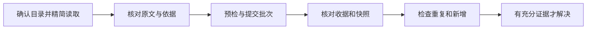
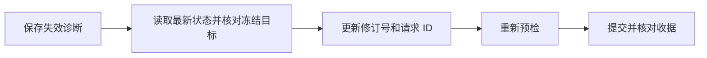

# 报告批注

跨查看、改稿、回复和解决的任务先读 [改稿闭环](workflow.md)。

`add/reply/edit` 支持 `--body-file`；`add` 支持 `--quote-file`。UTF-8 文件保留公式和换行，`-` 读取标准输入。对应文本参数互斥；一次调用只允许一个标准输入来源。

使用 `latex-review-annotations` 操作已有报告。命令缺失时用 `python -m latex_review.annotation_cli`，参数保持相同。批注写入不等于论文修改。

1. 确认本地报告目录。只有端口时，读取 `http://127.0.0.1:PORT/api/report` 的 `report_directory`。旧服务没有接口时查找启动记录，确认目录后再操作。
2. 查看 `--help`。先用摘要、字段、筛选和分页读取必要信息，再展开目标线程或正文。过滤 JSON 后展示结果。定位时保留完整原文；分页不是全文复核完成的证据。
3. 新增或回复时以自身名称署名。含行内公式的 quote 可以使用 `$...$` 或 `\(...\)`，公式内容必须相等。歧义时根据源码位置和上下文消歧；相近候选只供核对。完整公式使用 `--formula`。
4. 批量新增审查意见或复核已有批注时使用 `batch`。新增审查正文使用“问题、依据、建议”；复核回复使用下一步格式。给批次和每项设置唯一 ID，保存开始清单及修订号。预检后提交，核对逐条结果及 `snapshot_file`。相同请求 ID 的重试只返回原收据；修改载荷要用新 ID。
5. 仅在复核已有批注时，每条回复包含“判断、依据、剩余问题”。判断使用“已落实、采纳、部分采纳、不采纳、证据不足”。依据指向实际源码或检查结果。回复完成与问题解决分开；证据不足时保留未解决状态。
6. 核对退出码、消息、作者和父消息。批量结束检查自动 `audit`，必要时再次运行 `audit SNAPSHOT_FILE`。报告遗漏、重复回复和外部新增批注。冲突后重新读取；已成功项只核对，不重复提交。



~~~sh
latex-review-annotations REPORT_DIR --content --full --unit-id UNIT_ID
latex-review-annotations REPORT_DIR --summary --limit 20
latex-review-annotations REPORT_DIR --thread-id THREAD_ID --fields id,messages,association
latex-review-annotations REPORT_DIR add --quote '目标原文' --body '修改建议' --author Codex
latex-review-annotations REPORT_DIR reply THREAD_ID --body '回复内容' --author Codex
latex-review-annotations REPORT_DIR reply THREAD_ID --parent-message-id MESSAGE_ID --body '嵌套回复' --author Codex
latex-review-annotations REPORT_DIR edit THREAD_ID MESSAGE_ID --body '更新内容'
latex-review-annotations REPORT_DIR delete THREAD_ID --message-id MESSAGE_ID --yes
latex-review-annotations REPORT_DIR delete THREAD_ID --yes
latex-review-annotations REPORT_DIR resolve THREAD_ID
latex-review-annotations REPORT_DIR batch batch.json --request-id UNIQUE-ID --author Codex --dry-run
latex-review-annotations REPORT_DIR batch batch.json --request-id UNIQUE-ID --author Codex
latex-review-annotations REPORT_DIR audit SNAPSHOT_FILE
~~~

`add` 和 `reply` 分类默认为 `note`，可用 `--category question|suggestion|note` 指定。`edit` 保留作者，未指定分类时保留原分类。`reply` 默认回复初始批注；指定父消息时必须属于同一线程且未删除。
删除必须符合用户授权范围，并显式传 `--yes`。无 `--message-id` 时删除整条批注及其回复；删除记录保留，界面没有恢复入口。`resolve` 将整条批注标记为已解决。`reply --resolve` 原子提交回复和解决状态，只增加一次 revision；失败均不写入。
本机 CLI 写入论文项目共享存储；离线新增记录要先导出并导入，不能把磁盘结果当作离线数据。
高层写入默认返回 ID、修订号和成功状态；`--full` 返回完整结果。读取选项放在子命令之前。`add/reply --author` 可放在子命令前或后，后者优先。批量默认提交成功项；任何失败退出码为 4，仍须检查已经成功的项。`--atomic` 要求全部成功，`--dry-run` 只预检。
批量 JSON 格式及读取参数见下文。结构化替换见 [源码建议](suggestions.md)。现有 `--request` 接口继续用于导入、重新关联和重新打开。


## 摘要与历史

默认读取返回最多 50 条摘要，包含作者、消息预览、定位状态和源码位置。
使用 `--limit`、`--offset` 分页。`total_matched` 表示筛选后的总数。
`--author` 默认忽略大小写。
使用 `show ID`（或 `get ID`）读取完整消息、目标原文和当前位置。原有 `--thread-id ID --detail` 继续可用。
`--full` 用于诊断完整锚点；`--history` 用于关联历史。
正文坐标需要 `--content --full --unit-id ID`。保持完整原文，使用 UTF-16 坐标。
原选区删除后，批注可能保留所属段落或表格。容器导航不代表选区已经重新关联。

## 批量载荷与预检

批量文件接受项数组，或包含 `items`、`request_id`、`expected_revision`、`atomic` 的对象。
每项必须提供唯一 `id`。新增项示例：

```json
{"id":"review-1","operation":"add","quote":"目标原文","body":"问题：……依据：……建议：……"}
```

回复项使用 `operation=reply`、`thread_id`、`body`，可用 `parent_message_id` 指定父消息。
作者可在每项提供，或使用命令的 `--author`。
预检保存 15 分钟的缓存，不提交批注，也不消耗请求 ID。
提交默认复用相同请求 ID 的缓存，也可传 `--preflight-token TOKEN`。
正文版本、批注修订号或载荷变化后，重新预检。提交拒绝过期缓存。
CLI 进度写入 stderr；stdout 保持单个 JSON。使用 `--quiet-progress` 关闭进度。
提交返回 `results`、`revision`、`preflight_reused`、`audit`、`snapshot_file`。

## HTTP 后台任务

读取 `/api/annotations/status` 获取摘要及会话令牌。
页面数据使用 `?view=page`；完整数据使用 `?view=full`；修订检查使用 `?view=revision`。
将版本检查信封提交到 `/api/annotations/update?async=1`。
POST 需要 JSON 和 `X-LaTeX-Review-Token` 请求头。
响应为 HTTP 202，包含 `task_id` 和 `status_url`。
轮询 `status_url`，读取 `phase`、`completed`、`total` 和 `state`。
完成状态为 `complete`，结果保存在 `result`。失败状态为 `failed`，保留错误原因。
批量预检与提交沿用 `operation=batch`、`expected_revision`、`request_id`、`items`。
预检增加 `dry_run=true`；提交可以提供返回的 `preflight_token`。

## 标题、标签与轻量筛选

`--summary` 返回 `id`、`title`、`author`、`resolved`、`updated_at` 和 `tags`，不展开消息或锚点。
`author` 是初始消息作者。未设置标题时，使用初始消息首个非空行；列表标题最多 120 个字符。
`--fields id,title,author,resolved,tags` 可以进一步选字段。
`--tag` 精确匹配标签；重复指定时，线程必须包含全部标签。
`metadata --tag` 替换整组标签；未指定的字段保持原值。
标题最多 512 字节；最多 32 个标签，每个标签最多 128 字节，不能重复。
空标题恢复自动标题；`--clear-tags` 清空标签。

```sh
latex-review-annotations REPORT_DIR add --quote '目标原文' --body '修改建议' --author Codex --title '引言修改' --tag '非实验部分详细修改'
latex-review-annotations REPORT_DIR metadata THREAD_ID --title '引言修改' --tag '非实验部分详细修改' --tag '待复核'
latex-review-annotations REPORT_DIR metadata THREAD_ID --clear-tags
latex-review-annotations REPORT_DIR --summary --status unresolved --tag '非实验部分详细修改' --limit 20 --offset 0
latex-review-annotations REPORT_DIR --summary --status unresolved --author Codex --limit 20
latex-review-annotations REPORT_DIR --thread-id THREAD_ID --full
```

标题和标签先由 CLI/API 管理，网页不提供编辑控件。
旧线程无需迁移。旧版离线报告可能拒绝含标题或标签的备份；重新生成报告后导入。

## 按主题批量解决

1. 用标签和状态筛选轻量列表，检查 `total_matched`，读取全部分页。
2. 核对每条目标的证据，将确认的编号写入 `resolve.json`，冻结目标清单。
3. 保存查询返回的修订号，设置 `expected_revision`，使用 `--atomic --dry-run` 预检。
4. 核对逐项 `results`，使用同一请求 ID 和相同文件提交。
5. 检查 `committed`、逐项结果和自动 `audit`；再次读取目标确认解决状态。


以下 `17` 是示例修订号，执行时替换为查询返回的 `revision`。

```json
{
  "expected_revision": 17,
  "items": [
    {"id": "resolve-01", "operation": "resolve", "thread_id": "THREAD_1"},
    {"id": "resolve-02", "operation": "resolve", "thread_id": "THREAD_2"}
  ]
}
```

```sh
latex-review-annotations REPORT_DIR batch resolve.json --request-id resolve-topic-01 --atomic --dry-run
latex-review-annotations REPORT_DIR batch resolve.json --request-id resolve-topic-01 --atomic
latex-review-annotations REPORT_DIR audit SNAPSHOT_FILE
```

`batch` 还支持 `reopen` 和 `update_metadata`。更新标签项示例：

```json
{"id":"tag-01","operation":"update_metadata","thread_id":"THREAD_1","tags":["非实验部分详细修改"]}
```

## 预检失效后的固定重试

错误保留文字说明，并提供 `code`、`reasons`、`expected_revision` 和 `actual_revision`。
预检的 `expected_revision` 是缓存修订号；`request_expected_revision` 是本次请求修订号。
`reasons` 列出实际变化项：`annotation_revision_changed`、`content_changed`、`version_changed`、`payload_changed`、`expired` 或 `token_mismatch`。
缺失缓存使用 `preflight_missing`；损坏缓存使用 `preflight_invalid`。

1. 保存错误和原批次文件。先确认请求是否已提交；成功请求只核对原收据。
2. 重新读取正文和批注状态，核对冻结目标；保留其他审阅者的修改。
3. 更新 `expected_revision`。载荷不变且未提交时，沿用请求 ID；载荷变化时使用新 ID。
4. 重新执行 `--dry-run`，检查逐项结果，使用新预检令牌或同一请求 ID 提交。
5. 核对收据和 `audit`。部分成功批次只把失败项放入新批次，并使用新请求 ID。



## 新增审查与复核已有批注

新增当前全文审查按 [全文审查](editorial.md) 执行。检查范围由用户要求决定，不由已有批注决定。
新增项使用 `add`，正文保留“问题、依据、建议”和对应文件行号。
复核已有批注先筛选目标，再按需使用 `--detail` 读取每条完整消息。
核对源码或实际证据后，使用 `reply` 写入“判断、依据、剩余问题”。
只有证据充分时才使用 `resolve`；回复本身不代表问题解决。
`batch` 是批量提交工具，不是全文审查完成的证据。

## 精简详情与预检输出

```sh
latex-review-annotations REPORT_DIR --thread-id THREAD_ID --detail
latex-review-annotations REPORT_DIR add --file sections/introduction.tex --line 42 --quote '目标原文' --body '问题：……依据：……建议：……' --author Codex
latex-review-annotations REPORT_DIR batch review.json --request-id editorial-01 --author Codex --atomic --dry-run
latex-review-annotations REPORT_DIR batch review.json --request-id editorial-01 --author Codex --atomic --review-record review.md
```

`--detail` 返回完整消息、创建时原文、当前单元正文、当前选区和源码位置。
它省略原始锚点、历史锚点、历史编辑和各版本关联。未可靠关联时，当前位置为空。
选区已删除但容器保留时，`selection_deleted=true`；容器位置不代表选区恢复。
`--detail` 不与 `--full`、`--summary`、`--fields` 或 `--history` 混用。

批量默认返回逐项结果、开始数量、修订号和预检令牌，不返回全部已有批注编号。
预检返回 `preflight_file`，其中保留完整开始清单、原始输入和逐项结果。
提交返回 `snapshot_file`，其中保留完整收据。`batch --full` 显式展开开始编号清单。
`--review-record FILE.md` 在提交后导出独立 Markdown 记录，保留显示版本、文件行号、原文、意见、结果和批注编号。
部分成功时，记录同时保留失败项。再次提交相同请求 ID 只核对原收据，不重复添加。
记录导出失败时，响应保留已提交收据并提供 `review_record_error`；修复输出路径后用同一请求 ID 补导出。

## 文件、行号与原文联合定位

```json
{"id":"review-01","operation":"add","file":"sections/introduction.tex","line":42,"quote":"目标原文","body":"问题：……依据：……建议：……"}
```

`file` 为论文项目内相对 POSIX 路径。`line` 从 1 开始，并需要 `file`。
行号必须属于当前显示版本中可靠、连续、单文件的源码单元范围。
工具先筛选文件和行号，再匹配原文。范围结束行列采用半开区间。
只给 `file` 时可以缩小文件范围；复杂源码缺少可靠范围时，联合行号定位拒绝写入。
重复原文仍须用 `unit_id` 或 `occurrence` 消歧；工具不自动选择最近位置。
失败项返回候选用于核对。定位不读取当前磁盘来推算历史报告坐标。

## 显示版本与共享存储

**显示版本**是指定报告当前展示的新侧正文版本，由 `display_version_id` 标识。
CLI 查询与 `/api/report` 提供 `report_context`，包含报告目录、`kind`、项目身份、论文入口和显示版本。
`kind=live` 表示当前全文预览；`kind=diff` 表示差异报告；旧报告缺少可靠类型信息时返回 `unknown`。
同一论文的两类服务共享 `project_id` 和批注线程，分别使用独立服务槽位。
每个显示版本独立计算定位。共享批注线程不代表共享正文坐标。
两份报告的显示版本可以相同，也可以不同；换版后须重新读取当前位置。
全文审查使用当前全文预览；修改对比使用差异报告。目录名称或批注数量不能证明报告类型。
