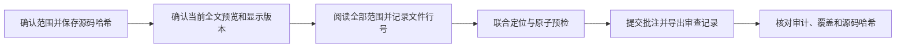

# 当前全文编辑性审查

使用当前全文审查论文语言、结构、论证或一致性，并新增审查意见。
此流程默认读取源码并写入批注，不修改论文源码，也不运行整篇 TeX 编译。
复核已有批注按 [批注](annotations.md#新增审查与复核已有批注) 执行。

1. 确认论文入口、项目根目录、审查范围和审查标准。保存范围内源码文件的哈希。
2. 用 `latex-review-local list` 发现已有服务。复用该论文的当前全文预览；需要新建时运行 `latex-review-live`。
3. 用批注查询的 `report_context` 核对项目、报告类型和显示版本。确认当前预览与待审源码一致。
4. 阅读范围内全部源码。逐项记录文件、行号、原文及“问题、依据、建议”；已有批注只用于避免重复。
5. 将新增意见写入批量文件。用文件、行号和原文联合定位，执行原子预检，逐项核对后提交并导出审查记录。
6. 核对收据、自动审计和审查范围覆盖。再次比较源码哈希，说明覆盖范围、未完成项、记录路径及服务保留状态。



## 可复用命令

```sh
latex-review-local list
latex-review-live main.tex
latex-review-annotations REPORT_DIR --summary --status unresolved --limit 20
latex-review-annotations REPORT_DIR --thread-id THREAD_ID --detail
latex-review-annotations REPORT_DIR batch review.json --request-id editorial-01 --author Codex --atomic --dry-run
latex-review-annotations REPORT_DIR batch review.json --request-id editorial-01 --author Codex --atomic --review-record review.md
```

```json
{
  "items": [
    {"id":"editorial-01","operation":"add","file":"sections/introduction.tex","line":42,"quote":"目标原文","body":"问题：……依据：……建议：……","tags":["全文编辑性审查"]}
  ]
}
```

`REPORT_DIR` 使用实际服务返回的报告目录，不能按目录名猜测。
当前服务目录可从 `http://127.0.0.1:PORT/api/report` 读取。
显示版本和共享线程的关系见 [版本说明](annotations.md#显示版本与共享存储)。
参数、定位限制、预检重试和精简输出见 [批注接口](annotations.md)。
命令缺失时，入口使用 `python -m latex_review.local_service`，预览使用 `python -m latex_review.live`，批注使用 `python -m latex_review.annotation_cli`。

## 完成条件

审查完成必须覆盖用户指定范围；提交意见数量不能证明全文覆盖。
源码与预览不一致时，先等待预览更新，再重新定位。审查期间源码变化时，重新核对受影响意见。
原文歧义或源码范围不可靠时，保留审查意见并报告定位未完成，不能自动选取相近位置。
独立记录须保留文件行号、显示版本、原文、意见和提交结果。成功项还须保留批注编号。
服务生命周期按 [持续预览](live.md#常驻入口操作) 执行。只清理本次临时新建槽位，保留复用服务。
