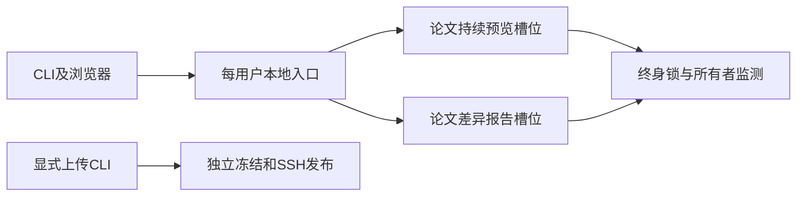

# 每用户常驻入口统一管理两类论文阅读服务

状态：设计已接受，T1–T5已实现，必要回归通过。日期：2026-10-13。

现有命令会为同一论文创建多个随机端口服务。重建锁只保护输出写入，不能保证服务唯一。
采用每用户一个常驻本地入口服务。论文身份复用真实根目录与主入口的批注 project_id。
每个论文身份分别拥有一个持续预览槽位和一个差异报告槽位。

入口默认绑定 `127.0.0.1:8765`。端口冲突明确失败；修改入口端口需要用户显式配置。
入口提供注册列表和稳定链接。稳定链接返回全屏内嵌报告页面，浏览器地址栏保持入口地址。报告仍在工作进程 origin 内运行，保留根路径 API 和本机权限边界。
差异报告服务使用独立报告副本。相同请求复用；新基线或参数按槽位串行替换。

入口与工作进程分别持有终身内核锁。工作进程监测所有者管道；入口崩溃后关闭服务并释放锁。
新入口不能绕过仍被持有的槽位锁。PID、状态 JSON 和端口仅提供诊断，不证明所有权。
重建子进程继承所有者管道读端，并独立登记和取消TeX任务组；任何子进程不继承写端。
持续预览通过完成候选目录后替换输出，生成失败保留上一份报告。
实现使用 Python 标准库，第一期支持 macOS 和 Linux，不引入 Web 框架或任务队列。

纯 `--upload` 保持独立同步路径，不查询或启动入口服务，不复用槽位报告，不按论文身份去重发布。
`--upload --open-browser` 仍先发布，再启动本地阅读；保留预览失败覆盖上传退出码的现有规则。
常驻启动成功后 CLI 返回，`--wait` 只附着状态。这是明确的生命周期变化。

不采用子路径代理，因为现有脚本依赖根路径 API 和精确本机 origin；代理增加改写和静态发布风险。
修订原302跳转决策：跳转会把浏览器地址栏改成随机工作端口，不符合固定入口的使用预期。
采用跨origin iframe；入口CSP只允许当前受管工作地址，报告不能读取入口令牌。
入口页面监测工作代次，替换后重新加载同一固定地址。报告静态产物和远程发布内容不变。
不采用每基线一个服务，因为它违反每论文差异报告服务唯一。不同基线保留为报告产物。
不采用 PID 文件排他或自动接管旧进程，因为 PID 复用和未知所有权会造成错误终止。

唯一性覆盖全部新 CLI 和模块入口启动的受管服务。用户须先停止升级前的无协议进程。
固定入口链接及地址栏稳定；替换后的旧工作进程直接链接可能失效。第一期不承诺无停机替换或原生 Windows 支持。

完整规格见[设计总结](../design/local-entry-service/design-summary.md)。
[Issue草稿](../design/local-entry-service/implementation-issue-draft.md)尚未发布。
用户已授权本轮实现，Issue发布不构成前置条件。发布后在此处追加真实Issue链接。
生产实现与验证记录见[实施状态](../design/local-entry-service/implementation-status.md)。
调查报告和隔离实验结果见[交付索引](../design/local-entry-service/README.md)。

## 2026-10-15：单入口端口转发

本修订取代上文的跨 origin iframe 和不采用子路径代理决定。
入口通过 `/papers/{paper_id}/{kind}/worker/` 代理当前受管服务。
iframe 和阅读 API 使用同源路径，静态产物仍可独立发布。
每次请求读取当前槽位，因此工作进程换端口不改变浏览器地址。
入口仅接受回环连接及回环 Host，浏览器端口可以不同于监听端口。
Origin 必须匹配请求 Host；拒绝跨站 Fetch Metadata，忽略转发头。
入口管理写入仍验证入口令牌，论文写入仍由工作进程验证论文令牌。
报告现在与入口同源，不再提供原有跨 origin 的令牌隔离。
