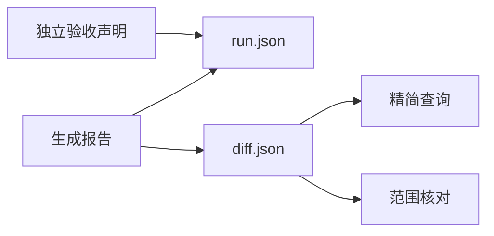
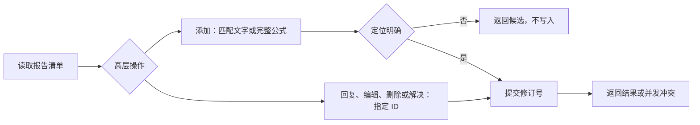
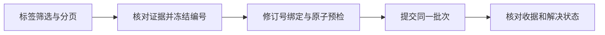
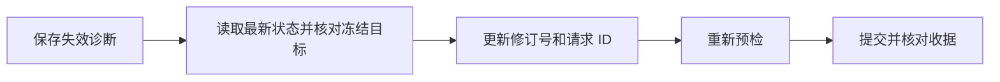

# 智能体接口

这些命令读取已有报告，不修改论文。查询与范围核对均以 `diff.json` 为依据，支持报告目录或差异文件路径。JSON 使用 UTF-8；命令成功返回 0，报告不可读取或契约无效返回 4，参数错误返回 2。错误也以 JSON 输出；参数错误由 argparse 输出到标准错误。

## 精简查询

```sh
latex-review-query .latex-review/latest
latex-review-query .latex-review/latest --file 'sections/*' --category citation
latex-review-query .latex-review/latest --section Introduction --limit 10 --offset 0
latex-review-query .latex-review/latest --change-id CHANGE_ID --include-raw
```

默认输出全报告摘要、全报告诊断级别计数，以及最多 50 项匹配主变更。每项包含 ID、操作、类别、说明、双侧源码位置、匹配置信度和章节路径。默认不输出节点原文或明细原文。`--include-raw` 增加双侧节点 LaTeX 和完整明细；不存在的一侧为 `null`。

`--file`、`--section`、`--category`、`--change-id` 均可重复。同类条件取并集，不同类条件取交集。文件与章节均检查双侧。章节匹配完整章节名称，或用 `/` 连接的完整章节路径；不做模糊匹配。类别包含变更明细中的类别。返回 `total_matched`、`limit`、`offset` 和当前页 `changes`。摘要保持全报告计数，不受筛选或分页影响。

文件模式使用区分大小写的相对 POSIX 路径。`*` 可以跨越 `/`，`**/` 可以匹配零层目录。绝对路径、反斜杠和 `..` 路径段会被拒绝。文件模式不读取当前 Git 状态。

## 修改范围核对

```sh
latex-review-check-scope .latex-review/latest --allow 'sections/intro.tex'
latex-review-check-scope .latex-review/latest --allow 'sections/*' --allow main.tex --strict
```

`--allow` 至少提供一次，路径以各比较版本的项目根目录为基准。新增检查新侧，删除检查旧侧，修改和移动检查双侧。

结果包含 `inside`、`outside`、`unknown` 三组，以及各组数量。任一已知文件超出允许范围，主变更归入 `outside`。没有已知范围外位置，但任一侧位置未知、置信度小于 1 或存在不确定理由时，主变更归入 `unknown`。其余主变更归入 `inside`。每项同时列出范围外侧和不确定侧，避免丢失部分未知信息。

默认只报告，不因范围外或无法判定改变退出码。`--strict` 在存在 `outside` 或 `unknown` 时返回 2。查询成功或核对成功不代表论文修改通过审阅。

## 运行结果清单

正常生成报告时，`latex-review` 自动写入 `run.json`。清单使用独立的 `schema_version: "1.0"`，不改变差异契约版本。

清单包含：

- 重建配方保存在 `.rebuild/recipe.json`，包含有效配置、可写新版入口和固定旧版来源。
- `baselines`：实际两侧来源标识、入口和内容指纹；来源失败时可能为空。
- `stages`：来源、解析、比较、编译、报告、上传和预览状态。
- `exit_code` 和 `status`：本次命令结果；完整为 `complete`，退出码 2 为 `degraded`，其他非零为 `failed`。
- `artifacts`：报告目录顶层交付文件的绝对路径；配套目录继续通过报告访问。
- `degradation_reasons`：来源、解析、编译、资源、上传或预览的失败与降级说明。
- `report_fingerprint`：差异、诊断和 HTML 文件的内容指纹，用于识别验收声明是否仍适用于报告。
- `browser_acceptance`：独立浏览器验收声明；初始为 `not_executed`。

Git 和工作区的 `content_fingerprint` 覆盖实际物化快照，`fingerprint_scope` 为 `materialized_snapshot`。指纹包含快照内未跟踪文件，遵守现有来源排除和忽略规则。目录和独立文件模式覆盖入口及已解析依赖，范围为 `entry_and_resolved_dependencies`。指纹不包含 API 密钥或文件原文。

阶段状态为 `not_executed`、`running`、`complete`、`degraded` 或 `failed`。上传或预览运行中，整体状态为 `running`，最终退出码为 `null`。源码降级报告不执行结构比较。清单不把浏览器自动打开视为验收通过。

参数或配置在输出准备前无效时，命令保留旧报告和旧清单。因此必须同时检查本次进程退出码，不能把旧清单当成本次结果。输出准备后发生来源或内部失败时，安全可写的目录仍有失败清单。`--help`、`--version` 和 `--inspect-sources` 不创建清单。预览启动后，清单先记录预览运行中；服务退出后更新最终状态。无法写入目录时，错误保留在标准错误。

## 记录浏览器验收声明

```sh
latex-review-record-acceptance .latex-review/latest \
  --status passed --evidence /absolute/path/browser-checks.txt \
  --evidence /absolute/path/screenshot.png --note '已检查公式、图片和导航'
```

`--status` 可选 `passed`、`failed` 或 `incomplete`。至少提供一个已经存在的证据文件。命令只保存调用者声明，不运行浏览器，也不验证证据内容是否足以证明通过。声明包含 `kind: "agent_declaration"`，不会更改 CLI 退出码或报告摘要。

报告指纹发生变化时，命令拒绝记录，返回 4。重新生成报告会重置验收状态。同一报告的预览结束时保留期间写入的声明。写入使用临时文件和原子替换；同一报告目录应只由一个写入者更新。



## 批注读取与修改

命令缺失时使用 `python -m latex_review.annotation_cli`，参数保持相同。
优先使用高层命令。命令自动读取项目、正文版本和当前修订号，无需创建请求 JSON。
`REPORT_DIR` 表示包含 `annotation-content.json` 的本地报告目录，也可传报告文件路径；不接受 HTTP 地址。

```sh
latex-review-annotations REPORT_DIR add --quote '目标原文' --body '修改建议' --author Codex
latex-review-annotations REPORT_DIR reply THREAD_ID --body '回复内容' --author Codex
latex-review-annotations REPORT_DIR reply THREAD_ID --parent-message-id MESSAGE_ID --body '嵌套回复' --author Codex
latex-review-annotations REPORT_DIR edit THREAD_ID MESSAGE_ID --body '更新内容'
latex-review-annotations REPORT_DIR delete THREAD_ID --message-id MESSAGE_ID --yes
latex-review-annotations REPORT_DIR delete THREAD_ID --yes
latex-review-annotations REPORT_DIR resolve THREAD_ID
```

`add` 和 `reply` 必须指定作者，身份固定为 `agent`；分类默认 `note`。
`--category` 可设为 `question`、`suggestion` 或 `note`。`edit` 保留原作者，未传分类时保留原分类。
`reply` 默认回复初始批注；`--parent-message-id` 必须属于同一线程，且消息未删除。
`delete --yes` 确认删除；无 `--message-id` 时删除整条批注及其回复。
`resolve` 标记整条批注为已解决；重新打开仍使用 JSON 接口的 `reopen` 操作。

`add --quote` 区分大小写，折叠连续 ASCII 空白并移除两端 ASCII 空格。
行内公式可直接使用 `$…$` 或 `\(…\)`；包装和无意义数学空白可以等价，公式内容必须相等。
只能在当前单个单元内匹配。既有 U+FFFC 输入仍兼容；新建定位不会自动采用近似候选。
重复原文返回 `error` 和 `candidates`，退出码为 4，不写入存储。
候选包含 `occurrence`、`selection`、`source`、`section_path` 和 `text`。
使用 `--unit-id` 缩小范围，或使用从 1 开始的 `--occurrence` 选择位置。
候选按正文顺序和单元内偏移排序；`--occurrence` 在 `--unit-id` 筛选后计数。
重新生成报告后，重新读取候选，不能沿用旧的单元 ID 或候选编号。

```sh
latex-review-annotations REPORT_DIR add --quote '重复原文' --occurrence 2 --body '修改建议' --author Codex
latex-review-annotations REPORT_DIR add --quote '原文' --unit-id UNIT_ID --body '修改建议' --author Codex
latex-review-annotations REPORT_DIR add --formula --quote '$x+1$' --body '公式问题' --author Codex
latex-review-annotations REPORT_DIR add --formula --unit-id UNIT_ID --body '公式问题' --author Codex
```

公式模式按完整原始 LaTeX 匹配，包含 `$…$`、`\\(…\\)` 或环境包装；也可只指定公式单元 ID。
高层写入默认返回 `success`、`thread_id`、`message_id`、`revision`、`version_id` 和 `request_id`。
没有请求 ID 的单条写入返回 `request_id=null`。子命令的 `--full` 返回完整视图；底层 `--request` 保持完整返回。
未匹配时最多返回三个相近片段，包含 `distance`、`context` 和 `diff`，不直接作为可靠选区。
长输入的候选诊断最多比较前 512 个字符，定位仍使用完整输入。
操作失败返回 JSON 错误和退出码 4；参数解析失败由 argparse 输出用法并返回 2。
命令不自动重试并发冲突。调用者需保留输入，重新读取并检查对象后再决定是否提交。
`--project-root` 等顶层选项放在子命令之前；子命令不能与旧读取或 JSON 请求模式混用。

默认读取返回最多 50 条摘要。摘要包含作者、消息预览、定位状态和源码位置，不携带完整锚点或历史。
使用 `--thread-id ID --detail` 读取完整消息、目标原文和当前位置。
使用 `--full` 展开诊断数据；使用 `--history` 按需展开历史。`--content` 也默认摘要，定位坐标使用 `--content --full`。
读取支持 `--summary`、`--fields`、`--limit`、`--offset`。分页返回 `total_matched`；`--author` 默认忽略大小写。
过滤参数为 `--thread-id`、`--unit-id`、`--status`、`--author`、`--kind`、`--tag`。

```sh
latex-review-annotations REPORT_DIR --summary --limit 20
latex-review-annotations REPORT_DIR --content --fields id,text,raw_latex,source --limit 20
latex-review-annotations REPORT_DIR --thread-id THREAD_ID --fields id,messages,association
curl --fail --silent http://127.0.0.1:PORT/api/report
```

本机 `GET /api/report` 返回 `report_directory`、报告地址及可用的项目身份。它复用 Host/Origin 校验，不返回写入 token。

### 批量与复核

`batch FILE --request-id ID --author NAME` 接受 JSON 数组，或包含 `items`、`request_id`、`expected_revision`、`atomic` 的对象。
每项需要唯一 `id` 和 `operation`。`add` 接受原文定位参数；底层 `create` 也可提交 `selection`。
`reply` 接受 `thread_id`、`parent_message_id` 或 `reply_to`。顶层作者为缺省作者，正文及分类复用单条校验。

```json
[
  {"id":"a1","operation":"add","quote":"目标 $x$ 原文","body":"修改理由","category":"suggestion"},
  {"id":"r1","operation":"reply","thread_id":"THREAD_ID","body":"判断：证据不足。依据：尚无实验记录。剩余问题：补充实验。"}
]
```

```sh
latex-review-annotations REPORT_DIR batch batch.json --request-id UNIQUE-ID --author Codex --dry-run
latex-review-annotations REPORT_DIR batch batch.json --request-id UNIQUE-ID --author Codex
latex-review-annotations REPORT_DIR batch batch.json --request-id OTHER-ID --author Codex --atomic
latex-review-annotations REPORT_DIR audit SNAPSHOT_FILE
```

默认提交成功项。任何项失败退出码为 4，不能假定整批未写入。`--atomic` 要求全部成功；`--dry-run` 不提交批注或消耗请求 ID。
预检保存 15 分钟的执行计划。提交自动复用相同请求 ID 的有效预检，也可传 `--preflight-token TOKEN`。
预检绑定正文版本、批注修订号、请求载荷及原子模式。任一值变化或缓存过期时，提交拒绝旧预检；重新预检后再提交。
CLI 将阶段及完成条数写到 stderr。stdout 保持单个 JSON；`--quiet-progress` 关闭进度。
响应包含 `preflight_token`、`preflight_expires_at` 和 `preflight_reused`。已提交请求仍返回原始幂等回执。
批量执行只复制受影响线程，不逐项复制所有正文版本。审计读取不执行锚点定位。响应提供全部 `results`、`committed` 和修订号。
相同请求 ID 和内容重试返回原收据；修订号不属于幂等载荷。不同内容使用相同 ID 返回冲突。
提交前保存线程快照，默认位于项目 `.latex-review/annotation-batches/`，响应返回 `snapshot_file`。
自动 `audit` 核对消息、作者、父消息、解决状态、标题、标签及重复回复；外部新增线程和消息单独列出。再次复核快照可以发现后续新增批注。
复核回复包含判断、依据和剩余问题。回复完成与问题解决分开；证据不足时保持未解决。

### 源码建议

`add`、`reply` 可传 `--original-chunk` 和 `--replacement-chunk`，替换使用原始 LaTeX，替换块可以为空。
`preview THREAD_ID MESSAGE_ID` 返回差异，不修改源码或修订号。`apply THREAD_ID MESSAGE_ID` 显式回写。
应用验证可靠单文件区间、全文指纹、原文和修订号；过期或不可写建议拒绝应用。
结果包含 `source_changed` 和 `rebuild`，不自动解决线程。Web 提供相同的差异预览与接受入口。
新报告保存重建配方并固定旧版来源。成功后切换报告，保留 `previous_report`；失败或缺少配方返回 `pending`，说明源码已修改、报告待更新。
简单图注和单元格提供 `subunit`、`source_span`。第一行使用结构性的 `header` 身份。复杂结构提供只读降级理由，不增加主变更计数。



以下 JSON 和 HTTP 接口继续保留，用于导入、重新关联等结构化操作。

正文坐标来自报告清单，不能使用 MathJax 内部文字。

```sh
latex-review-annotations /path/to/report --content --full
latex-review-annotations /path/to/report --export > annotations.json
latex-review-annotations /path/to/report --request request.json
```

先读取当前 `project_id`、`version_id` 和 `revision`，再提交完整信封。

```json
{
  "project_id": "当前项目的64位哈希",
  "version_id": "当前正文的64位哈希",
  "request": {
    "operation": "create",
    "expected_revision": 0,
    "selection": {"unit_id": "清单中的单元ID", "start": 0, "end": 4, "quote": "实际原文", "side": "new"},
    "body": "请核查此处的 $x$。",
    "author": {"name": "Codex", "type": "agent"},
    "category": "question"
  }
}
```

本机 HTTP 使用 `GET /api/annotations/content`、`GET /api/annotations/status` 和
`POST /api/annotations/update`。POST 需要状态接口返回的 token，放入 `X-LaTeX-Review-Token`。
状态接口默认摘要。`?view=page` 返回页面消息及当前关联，省略历史正文；`?view=full` 显式展开完整视图。
`?view=revision` 只返回项目、正文版本和批注修订号，不执行定位。
使用 `POST /api/annotations/update?async=1` 启动后台任务，立即返回 HTTP 202、`task_id`、`status_url`。
轮询 `status_url` 获取阶段、`completed`、`total`。`state=complete` 时读取 `result`；`state=failed` 时读取 `error` 和 `message`。
`GET /api/annotations/jobs` 返回当前任务进度。进度查询不取得批注存储锁，报告页面会显示后台任务进度。
`GET /api/annotations/history?thread_id=ID` 按需展开指定批注的完整关联历史。
回复使用 `operation=reply`、`thread_id`、正文、作者和分类。
编辑使用 `operation=edit`、`thread_id`、`message_id`、正文和分类。
换版迁移使用 `operation=reconcile`。手动关联使用 `operation=associate` 和新版本选区。
冲突时保留输入，重新读取修订号后检查对象。不要自动覆盖冲突。
完整字段及导入规则见 [批注契约](report-annotations-contract.md)。


## 标题、标签与轻量筛选

`--summary` 返回 `id`、`title`、`author`、`resolved`、`updated_at` 和 `tags`，不展开消息或锚点。
`author` 是初始消息作者。未设置标题时，使用初始消息首个非空行；列表标题最多 120 个字符。
`--fields id,title,author,resolved,tags` 可以进一步选字段。
`--tag` 精确匹配标签；重复指定时，线程必须包含全部标签。
`metadata --tag` 替换整组标签；未指定的字段保持原值。
标题最多 512 字节；最多 32 个标签，每个标签最多 128 字节，不能重复。
空标题恢复自动标题；`--clear-tags` 清空标签。

```sh
latex-review-annotations REPORT_DIR add --quote '目标原文' --body '修改建议' --author Codex --title '引言修改' --tag '非实验部分详细修改'
latex-review-annotations REPORT_DIR metadata THREAD_ID --title '引言修改' --tag '非实验部分详细修改' --tag '待复核'
latex-review-annotations REPORT_DIR metadata THREAD_ID --clear-tags
latex-review-annotations REPORT_DIR --summary --status unresolved --tag '非实验部分详细修改' --limit 20 --offset 0
latex-review-annotations REPORT_DIR --summary --status unresolved --author Codex --limit 20
latex-review-annotations REPORT_DIR --thread-id THREAD_ID --full
```

标题和标签先由 CLI/API 管理，网页不提供编辑控件。
旧线程无需迁移。旧版离线报告可能拒绝含标题或标签的备份；重新生成报告后导入。

## 按主题批量解决

1. 用标签和状态筛选轻量列表，检查 `total_matched`，读取全部分页。
2. 核对每条目标的证据，将确认的编号写入 `resolve.json`，冻结目标清单。
3. 保存查询返回的修订号，设置 `expected_revision`，使用 `--atomic --dry-run` 预检。
4. 核对逐项 `results`，使用同一请求 ID 和相同文件提交。
5. 检查 `committed`、逐项结果和自动 `audit`；再次读取目标确认解决状态。



以下 `17` 是示例修订号，执行时替换为查询返回的 `revision`。

```json
{
  "expected_revision": 17,
  "items": [
    {"id": "resolve-01", "operation": "resolve", "thread_id": "THREAD_1"},
    {"id": "resolve-02", "operation": "resolve", "thread_id": "THREAD_2"}
  ]
}
```

```sh
latex-review-annotations REPORT_DIR batch resolve.json --request-id resolve-topic-01 --atomic --dry-run
latex-review-annotations REPORT_DIR batch resolve.json --request-id resolve-topic-01 --atomic
latex-review-annotations REPORT_DIR audit SNAPSHOT_FILE
```

`batch` 还支持 `reopen` 和 `update_metadata`。更新标签项示例：

```json
{"id":"tag-01","operation":"update_metadata","thread_id":"THREAD_1","tags":["非实验部分详细修改"]}
```

## 预检失效后的固定重试

错误保留文字说明，并提供 `code`、`reasons`、`expected_revision` 和 `actual_revision`。
预检的 `expected_revision` 是缓存修订号；`request_expected_revision` 是本次请求修订号。
`reasons` 列出实际变化项：`annotation_revision_changed`、`content_changed`、`version_changed`、`payload_changed`、`expired` 或 `token_mismatch`。
缺失缓存使用 `preflight_missing`；损坏缓存使用 `preflight_invalid`。

1. 保存错误和原批次文件。先确认请求是否已提交；成功请求只核对原收据。
2. 重新读取正文和批注状态，核对冻结目标；保留其他审阅者的修改。
3. 更新 `expected_revision`。载荷不变且未提交时，沿用请求 ID；载荷变化时使用新 ID。
4. 重新执行 `--dry-run`，检查逐项结果，使用新预检令牌或同一请求 ID 提交。
5. 核对收据和 `audit`。部分成功批次只把失败项放入新批次，并使用新请求 ID。



## 精简详情与预检输出

```sh
latex-review-annotations REPORT_DIR --thread-id THREAD_ID --detail
latex-review-annotations REPORT_DIR add --file sections/introduction.tex --line 42 --quote '目标原文' --body '问题：……依据：……建议：……' --author Codex
latex-review-annotations REPORT_DIR batch review.json --request-id editorial-01 --author Codex --atomic --dry-run
latex-review-annotations REPORT_DIR batch review.json --request-id editorial-01 --author Codex --atomic --review-record review.md
```

`--detail` 返回完整消息、创建时原文、当前单元正文、当前选区和源码位置。
它省略原始锚点、历史锚点、历史编辑和各版本关联。未可靠关联时，当前位置为空。
选区已删除但容器保留时，`selection_deleted=true`；容器位置不代表选区恢复。
`--detail` 不与 `--full`、`--summary`、`--fields` 或 `--history` 混用。

批量默认返回逐项结果、开始数量、修订号和预检令牌，不返回全部已有批注编号。
预检返回 `preflight_file`，其中保留完整开始清单、原始输入和逐项结果。
提交返回 `snapshot_file`，其中保留完整收据。`batch --full` 显式展开开始编号清单。
`--review-record FILE.md` 在提交后导出独立 Markdown 记录，保留显示版本、文件行号、原文、意见、结果和批注编号。
部分成功时，记录同时保留失败项。再次提交相同请求 ID 只核对原收据，不重复添加。
记录导出失败时，响应保留已提交收据并提供 `review_record_error`；修复输出路径后用同一请求 ID 补导出。

## 文件、行号与原文联合定位

```json
{"id":"review-01","operation":"add","file":"sections/introduction.tex","line":42,"quote":"目标原文","body":"问题：……依据：……建议：……"}
```

`file` 为论文项目内相对 POSIX 路径。`line` 从 1 开始，并需要 `file`。
行号必须属于当前显示版本中可靠、连续、单文件的源码单元范围。
工具先筛选文件和行号，再匹配原文。范围结束行列采用半开区间。
只给 `file` 时可以缩小文件范围；复杂源码缺少可靠范围时，联合行号定位拒绝写入。
重复原文仍须用 `unit_id` 或 `occurrence` 消歧；工具不自动选择最近位置。
失败项返回候选用于核对。定位不读取当前磁盘来推算历史报告坐标。

## 显示版本与共享存储

**显示版本**是指定报告当前展示的新侧正文版本，由 `display_version_id` 标识。
CLI 查询与 `/api/report` 提供 `report_context`，包含报告目录、`kind`、项目身份、论文入口和显示版本。
`kind=live` 表示当前全文预览；`kind=diff` 表示差异报告；旧报告缺少可靠类型信息时返回 `unknown`。
同一论文的两类服务共享 `project_id` 和批注线程，分别使用独立服务槽位。
每个显示版本独立计算定位。共享批注线程不代表共享正文坐标。
两份报告的显示版本可以相同，也可以不同；换版后须重新读取当前位置。
全文审查使用当前全文预览；修改对比使用差异报告。目录名称或批注数量不能证明报告类型。


## 单条查看与安全文本输入

`latex-review-annotations REPORT_DIR show THREAD_ID` 返回单个 `thread` 的完整消息、原文和当前位置。`get` 是同义命令。不存在或已删除的批注返回错误。

`add/reply --author` 可以放在子命令前或后；两处同时指定时，子命令后的作者优先。其他读取参数放在子命令之前。

`add/reply/edit --body-file FILE` 和 `add --quote-file FILE` 读取 UTF-8 文本。路径 `-` 表示标准输入；一次调用仅允许一个标准输入来源。对应文本参数互斥，正文保留公式和换行。

`reply THREAD_ID --body-file evidence.txt --author Codex --resolve` 在同一事务中回复并解决，只增加一次 revision。失败均不写入。普通回复保持原解决状态。

完整操作流程见 [批注改稿闭环](../.agents/skills/latex-review/references/workflow.md)。
