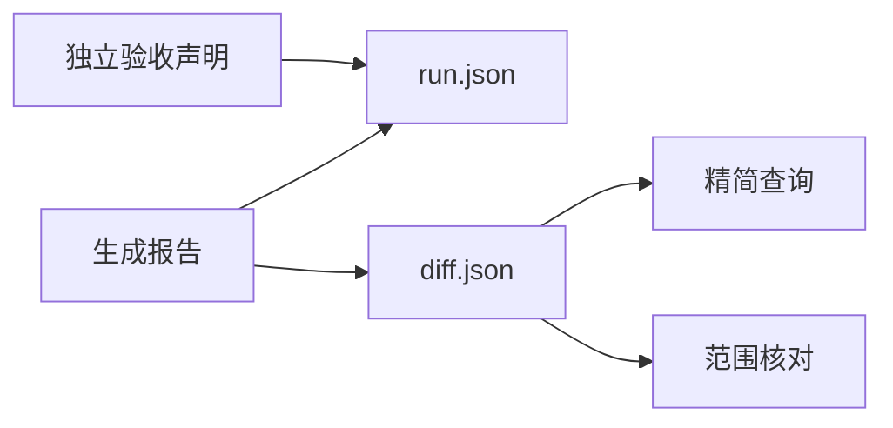

# 智能体接口

这些命令读取已有报告，不修改论文。查询与范围核对均以 `diff.json` 为依据，支持报告目录或差异文件路径。JSON 使用 UTF-8；命令成功返回 0，报告不可读取或契约无效返回 4，参数错误返回 2。错误也以 JSON 输出；参数错误由 argparse 输出到标准错误。

## 精简查询

```sh
latex-review-query .latex-review/latest
latex-review-query .latex-review/latest --file 'sections/*' --category citation
latex-review-query .latex-review/latest --section Introduction --limit 10 --offset 0
latex-review-query .latex-review/latest --change-id CHANGE_ID --include-raw
```

默认输出全报告摘要、全报告诊断级别计数，以及最多 50 项匹配主变更。每项包含 ID、操作、类别、说明、双侧源码位置、匹配置信度和章节路径。默认不输出节点原文或明细原文。`--include-raw` 增加双侧节点 LaTeX 和完整明细；不存在的一侧为 `null`。

`--file`、`--section`、`--category`、`--change-id` 均可重复。同类条件取并集，不同类条件取交集。文件与章节均检查双侧。章节匹配完整章节名称，或用 `/` 连接的完整章节路径；不做模糊匹配。类别包含变更明细中的类别。返回 `total_matched`、`limit`、`offset` 和当前页 `changes`。摘要保持全报告计数，不受筛选或分页影响。

文件模式使用区分大小写的相对 POSIX 路径。`*` 可以跨越 `/`，`**/` 可以匹配零层目录。绝对路径、反斜杠和 `..` 路径段会被拒绝。文件模式不读取当前 Git 状态。

## 修改范围核对

```sh
latex-review-check-scope .latex-review/latest --allow 'sections/intro.tex'
latex-review-check-scope .latex-review/latest --allow 'sections/*' --allow main.tex --strict
```

`--allow` 至少提供一次，路径以各比较版本的项目根目录为基准。新增检查新侧，删除检查旧侧，修改和移动检查双侧。

结果包含 `inside`、`outside`、`unknown` 三组，以及各组数量。任一已知文件超出允许范围，主变更归入 `outside`。没有已知范围外位置，但任一侧位置未知、置信度小于 1 或存在不确定理由时，主变更归入 `unknown`。其余主变更归入 `inside`。每项同时列出范围外侧和不确定侧，避免丢失部分未知信息。

默认只报告，不因范围外或无法判定改变退出码。`--strict` 在存在 `outside` 或 `unknown` 时返回 2。查询成功或核对成功不代表论文修改通过审阅。

## 运行结果清单

正常生成报告时，`latex-review` 自动写入 `run.json`。清单使用独立的 `schema_version: "1.0"`，不改变差异契约版本。

清单包含：

- `requested_sources`：本次解析后的来源选项。
- `baselines`：实际两侧来源标识、入口和内容指纹；来源失败时可能为空。
- `stages`：来源、解析、比较、编译、报告、上传和预览状态。
- `exit_code` 和 `status`：本次命令结果；完整为 `complete`，退出码 2 为 `degraded`，其他非零为 `failed`。
- `artifacts`：报告目录顶层交付文件的绝对路径；配套目录继续通过报告访问。
- `degradation_reasons`：来源、解析、编译、资源、上传或预览的失败与降级说明。
- `report_fingerprint`：差异、诊断和 HTML 文件的内容指纹，用于识别验收声明是否仍适用于报告。
- `browser_acceptance`：独立浏览器验收声明；初始为 `not_executed`。

Git 和工作区的 `content_fingerprint` 覆盖实际物化快照，`fingerprint_scope` 为 `materialized_snapshot`。指纹包含快照内未跟踪文件，遵守现有来源排除和忽略规则。目录和独立文件模式覆盖入口及已解析依赖，范围为 `entry_and_resolved_dependencies`。指纹不包含 API 密钥或文件原文。

阶段状态为 `not_executed`、`running`、`complete`、`degraded` 或 `failed`。上传或预览运行中，整体状态为 `running`，最终退出码为 `null`。源码降级报告不执行结构比较。清单不把浏览器自动打开视为验收通过。

参数或配置在输出准备前无效时，命令保留旧报告和旧清单。因此必须同时检查本次进程退出码，不能把旧清单当成本次结果。输出准备后发生来源或内部失败时，安全可写的目录仍有失败清单。`--help`、`--version` 和 `--inspect-sources` 不创建清单。预览启动后，清单先记录预览运行中；服务退出后更新最终状态。无法写入目录时，错误保留在标准错误。

## 记录浏览器验收声明

```sh
latex-review-record-acceptance .latex-review/latest \
  --status passed --evidence /absolute/path/browser-checks.txt \
  --evidence /absolute/path/screenshot.png --note '已检查公式、图片和导航'
```

`--status` 可选 `passed`、`failed` 或 `incomplete`。至少提供一个已经存在的证据文件。命令只保存调用者声明，不运行浏览器，也不验证证据内容是否足以证明通过。声明包含 `kind: "agent_declaration"`，不会更改 CLI 退出码或报告摘要。

报告指纹发生变化时，命令拒绝记录，返回 4。重新生成报告会重置验收状态。同一报告的预览结束时保留期间写入的声明。写入使用临时文件和原子替换；同一报告目录应只由一个写入者更新。


