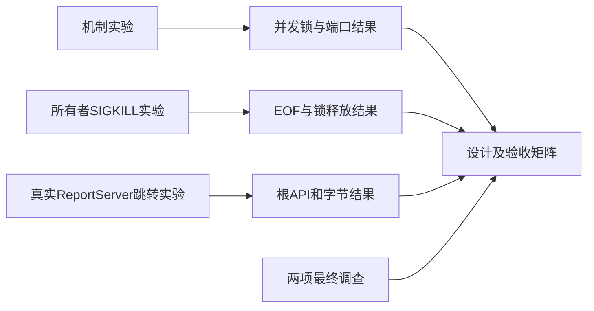

# 常驻本地入口服务设计交付

日期：2026-10-13。状态：设计完成，T1–T5已实现，必要回归通过。GitHub Issue尚未发布。
本目录保存最终设计和关键证据。原始临时文件保留，不修改其他调查负责人的原文件。

## 文件索引

| 文件 | 内容 |
| --- | --- |
| [实施状态](implementation-status.md) | 公共命令、源码接入、实施调整及验证记录 |
| [设计总结](design-summary.md) | 设计树、决策、源码接入点、20项验收、6项实施任务和限制 |
| [Issue草稿](implementation-issue-draft.md) | 可发布规格；尚未创建Issue |
| [ADR](../../adr/0002-resident-local-entry.md) | 常驻入口、两个槽位及上传隔离决策 |
| [入口调查](process-audit.md) | 当前生命周期、重复服务和并发写入实验 |
| [上传调查](upload-audit.md) | 发布契约、46项既有测试和7项隔离验证 |
| [锁与端口结果](design-probe-results.json) | 24进程争锁、管道关闭、端口冲突及符号链接身份 |
| [所有者崩溃结果](design-owner-crash-results.json) | SIGKILL后工作进程观察EOF并释放锁 |
| [跳转结果](design-redirect-results.json) | 302跳转真实ReportServer，根API与报告字节保持 |

本仓库使用大写`Docs`目录。上述链接遵循仓库实际大小写。
发布Issue时，应将正文中的相对文档链接转换为实际仓库文件URL。
本文没有假定或填写尚不存在的Issue编号。

## 执行方法与结果

原始实验根目录为`/tmp/latex-review-local-entry-20261013/`。
以下命令记录当时执行方法；本次持久化整理没有重新运行实验。
仓库虚拟环境提供产品依赖。机制实验只使用Python标准库。

1. 执行`python3 /tmp/latex-review-local-entry-20261013/design-probe.py`。
2. 执行`python3 /tmp/latex-review-local-entry-20261013/design-owner-crash.py`。
3. 在仓库执行`PYTHONPATH=src .venv/bin/python /tmp/latex-review-local-entry-20261013/design-redirect.py`。
4. 入口与上传调查的具体执行命令见各自报告。

锁实验使用spawn创建24个进程，并通过同一Event同步开始抢锁。
每个进程对同一个本地文件执行`flock(LOCK_EX | LOCK_NB)`；成功者短暂持锁。
结果为1个owner和23个busy。关闭所有者管道后，工作进程退出，锁可重新取得。
实验还对已监听端口执行第二次bind，并比较真实目录与符号链接的resolve结果。

崩溃实验让所有者通过专用管道连接独立session工作进程。
工作进程取得槽位锁，并发布ready文件。控制器先确认锁忙，再向所有者发送SIGKILL。
工作进程观察EOF后释放锁。实验记录12毫秒后成功重新取得锁。
实验只使用自己创建的进程，没有终止既有服务。

跳转实验创建临时报告，并启动真实`create_server`和一个临时302入口。
客户端跟随稳定路径，随后请求工作进程的`/api/report`。
正文和API均成功；API返回的报告URL匹配跳转地址；报告字节哈希保持不变。
finally关闭两个服务并等待线程退出。

## 证据范围与限制

三份JSON是最终结果副本。机制实验运行平台为macOS；没有在Linux或Windows重复执行。
24进程锁实验验证本机flock，不证明网络文件系统排他性。
EOF实验没有运行TeX，不证明完整编译取消、任务组清理或全部描述符继承已正确。
跳转实验使用HTTP客户端，未验证完整浏览器交互、翻译和源码建议重建。
候选副本、发布冻结一致性及完整入口服务仍需实施验收。

入口调查验证10个实验进程，并记录同输出临时文件争用。
上传调查使用mock SSH和临时接收目录，没有执行线上发布。
两个调查报告保留原调查叙述；其中“git status为空”仅描述各自调查开始及结束时刻。
原脚本和完整日志仍在临时目录；临时目录清理后，它们可能不可用。
本目录保留执行方法、最终结果和限制，不承诺完整原始实验环境长期存在。

固定地址栏修复及新验证见[固定地址修复记录](stable-address-validation.md)。早期302实验仅记录原设计。
