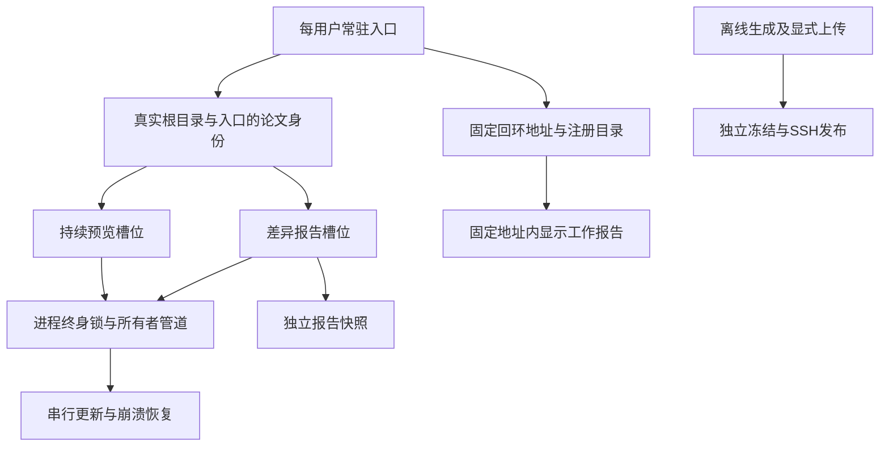
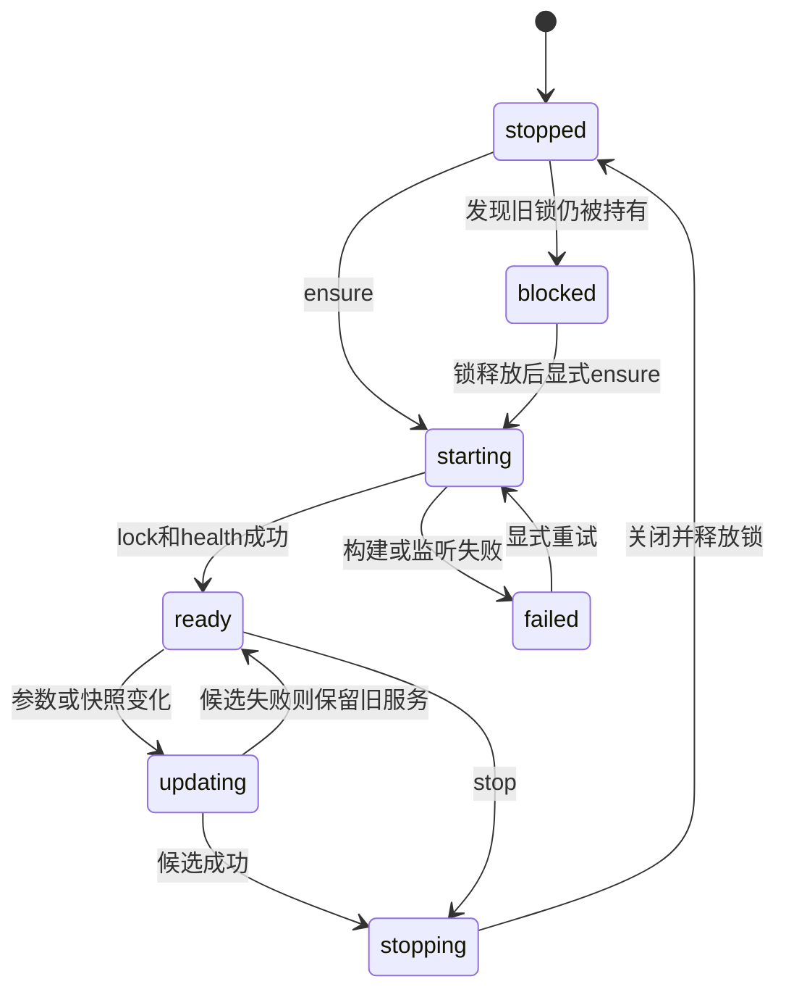

# 常驻本地入口服务设计

日期：2026-10-13。状态：设计完成，T1–T5生产实现已接入。最终验收见[实施状态](implementation-status.md)。
原设计阶段只写文档和隔离实验。用户随后授权生产实现；当前状态见实施状态。

## 目标与边界

每个用户拥有一个本地入口服务。它列出已注册论文，并管理两类服务。
每个论文身份至多拥有一个持续预览进程、一个差异报告服务。
此限制不限制离线报告生成、TeX 编译或远程发布任务。
入口无需扫描任意磁盘。CLI 注册论文，入口列出持久注册记录。
第一期支持 macOS 和 Linux。原生 Windows 不纳入第一期，现有代码依赖 fcntl。
服务状态和锁须位于本机文件系统。不同用户、容器和主机各自管理自己的服务。

## 设计树与逐轮挑战

用户授权设计负责人决定技术分支。下列记录替代逐项向用户确认。
每轮只处理前置条件已明确的分支。事实调查未完成时，不采用其结论。

| 轮次 / 分支 | 挑战与反例 | 最终决策与代价 |
| --- | --- | --- |
| 1 / 常驻范围 | 系统级守护进程需要权限，并混合用户凭据。每个仓库守护进程无法统一发现。 | 每用户一个服务。首次受管 CLI 请求自动启动；退出 CLI 后继续运行。 |
| 1 / 启动依赖 | launchd/systemd 分别维护，增加安装复杂度。 | Python 标准库后台子进程；提供 start/run/status/stop/open。暂不自动登录启动。 |
| 1 / 地址 | 随机端口使收藏失效。固定端口可能被其他软件占用。 | 默认 http://127.0.0.1:8765/。冲突时失败，不静默换端口。用户可显式更改并持久化端口。 |
| 1 / 展示 | 子路径代理会破坏根路径 /api/、Host 校验和静态发布。 | 入口页面用全屏iframe显示报告，地址栏保持固定入口。报告仍使用现有根路由和独立回环端口。 |
| 1 / 依赖 | Web 框架、数据库和任务队列是否必要？ | 不必要。标准库 HTTP、fcntl、线程、subprocess 和原子 JSON 足够。 |
| 2 / 身份 | 输出目录、baseline、Git HEAD 都会变化。文件名会在不同项目重复。 | 复用批注 project_id：真实根目录和根内入口共同标识。baseline 和参数不进入实例键。 |
| 2 / 服务数量 | 每次新输出建服务会违反每论文唯一。只锁构建仍允许多个监听进程。 | 槽位键为 (project_id, live 或 diff)。工作进程持有槽位内核锁直至退出。 |
| 2 / 报告独立性 | 服务读取 CLI 输出时，下一次 upload 生成会改掉页面。 | 差异报告服务读取自己的完整报告副本；离线生成和上传保留原输出。 |
| 2 / 存储 | SQLite 提供事务，但进程锁和 HTTP 生命周期仍需独立实现。 | 服务唯一写注册 JSON。替换前 fsync 文件，os.replace 后 fsync 目录。PID 只作诊断。 |
| 2 / CLI 兼容 | 常驻后 Ctrl+C 杀掉共享服务，会影响其他客户端。 | 原参数继续解析；启动成功即返回。新增 --wait 只附着状态，Ctrl+C 只断开客户端。明确文档化生命周期变化。 |
| 3 / 更新 | 新 baseline 是否再建第二服务？自动“最后请求获胜”会隐藏请求丢失。 | 同槽位 FIFO 更新；最多16项等待，满队列返回429。每个请求返回操作 ID。完全相同请求合并。 |
| 3 / 失败 | 先停旧服务再构建，新构建失败会丢失可读报告。 | 先生成或复制完整候选快照，再停旧服务并等待锁释放，随后启动替代服务。失败保留旧快照。 |
| 3 / 崩溃 | 仅有 PID 文件会误杀复用 PID。入口崩溃后孤儿进程会与新服务重叠。 | 所有者管道 EOF 使工作进程关闭 HTTP 和其任务。锁未释放时，新入口禁止再启动同槽位。 |
| 3 / 恢复 | 自动恢复全部编译会造成启动风暴。 | 注册记录保留。重启先显示 stopped/blocked；用户请求时恢复。损坏 JSON 隔离保存，禁止凭猜测杀进程。 |
| 4 / 旧进程 | 旧版本无实例锁，不能可靠控制其全部进程。 | 升级前要求用户停止旧入口。自动迁移只读元数据，不接管或杀未知 PID。唯一性保证明确限定受管进程。 |
| 4 / 上传 | 上传排入入口队列会依赖入口在线。复用当前报告会发布旧 baseline。 | 上传同步独立执行。纯 --upload 不注册、不启动、不停止本地服务。 |
| 4 / 发布退出码 | 当前预览失败会覆盖上传失败码16。悄悄修复会破坏脚本。 | 保留优先级：指定 --open-browser 且启动失败时返回4。上传仍先执行，run.json 分别记录两阶段。 |
| 4 / 跨平台 | 当前 fcntl 和 POSIX 子进程语义未经 Windows 验证。 | 第一期开 macOS/Linux；Windows 属于独立实施规格，不声称已支持。 |

## 领域定义与身份算法

论文身份沿用 annotations.build_content 的哈希算法。普通规范来源保持原project_id；旧别名兼容见身份兼容补充。
当前磁盘来源的根目录先 expanduser 和 resolve(strict=True)。入口先 resolve，再验证位于根目录内。
Git历史来源按真实worktree根和历史入口元数据规范化；历史入口可不在当前磁盘，不能强制其当前存在。
入口保存为根内 POSIX 相对路径。随后调用同一规范哈希工具，输入 {root, entry}。
应抽出纯 identity.py，保持旧哈希字节序列完全相同；批注存储身份不变。
符号链接别名合并；路径大小写不自行 lower。Git worktree、项目副本和移动后的根目录分别视为新身份。
硬链接和不同网络挂载别名不合并。用户显式 --root 的不同根目录可能产生不同身份；CLI 必须展示根目录。

已有报告通过 annotation-content.json 的 project_root、entry、project_id 注册。
服务核验原元数据并计算规范服务键，不按 output 或 PID 反推论文身份。源码降级报告缺少身份时，CLI 在生成时提供身份。
直接预览无法确定身份的旧报告，须用新增 --entry 和 --root 注册；缺失时返回4，说明恢复命令。
历史 Git 来源使用 worktree_origin，而非临时解包目录。

## 入口生命周期、协议与权限

新增 latex-review-local 命令，提供 start、run、status、stop、open、list、stop-paper。
run 前台运行入口，用于诊断。start 自动后台运行，不注册操作系统登录项。
入口没有闲置自动退出。stop 拒绝新请求，取消排队任务，关闭受管工作进程及其任务，然后退出。
SIGTERM 使用同一退出路径。正常退出最多等待5秒，再终止确认属于本次服务的进程组。
SIGKILL 后工作进程由 EOF 监测独立退出；不会依赖主事件循环是否正在等待文件事件。

macOS 状态根为 ~/Library/Application Support/latex-review/local-service。
Linux 状态根为绝对 XDG_STATE_HOME/latex-review/local-service，默认 ~/.local/state/latex-review/local-service。
状态目录0700，文件0600。锁文件不删除，以避免不同 inode 的锁同时生效。
全局 local.lock 在任何状态修改和绑定前取得，启动进程整个生命周期持有。
config.json 保存固定入口端口；endpoint.json 保存协议版本、实例随机 nonce、PID、地址和本次 token。
registry.json 保存论文身份、原始来源、两槽位最后有效配方、快照路径和代次；不保存凭据内容。
状态文件不是锁，也不是进程存活证据。客户端验证协议、nonce 和实际 health 响应。
协议版本不兼容时返回明确错误，要求退出旧入口后升级；不启动第二入口。
并发自动启动均使用同一全局锁；败者只等待匹配health，超时返回4。
先实际bind和取得实例身份，再原子发布endpoint；退出时只移除匹配本次nonce的endpoint。

所有服务只绑定127.0.0.1。没有0.0.0.0、localhost解析或IPv6双栈隐式行为。
所有入口请求校验精确 Host；有 Origin 时必须匹配当前入口 origin。
写请求须带随机 token；token只在权限受限 endpoint文件和同源管理页取得。
不启用CORS。校验JSON大小、路径、动作和Content-Type；无token或错误Origin返回403。
入口不将令牌放入报告URL，不向报告页面注入入口API配置，不接受任意远程URL。
现有工作进程翻译和批注token保持原语义。入口和工作进程端口不同，报告不能读取入口token。

| 接口 | 契约 |
| --- | --- |
| GET /health | 协议版本、实例nonce；不改变服务 |
| GET /api/v1/papers | 已注册论文与两槽位状态，过滤凭据 |
| POST /api/v1/papers/register | CLI提供规范身份和已有报告；验证后写注册记录 |
| POST /api/v1/papers/{id}/{live,diff}/ensure | 规范请求、request_id；202返回operation_id和稳定URL |
| GET /api/v1/operations/{id} | queued/starting/ready/failed/cancelled与诊断；失败不得伪装ready |
| POST /api/v1/papers/{id}/{live,diff}/stop | 显式停止槽位；幂等；不删报告和注册记录 |
| POST /api/v1/shutdown | 显式停止入口及所有受管服务 |
| GET /papers/{id}/{live,diff} | ready时返回全屏iframe页面，地址栏保持入口地址；否则显示诊断与受保护启动表单 |

稳定收藏链接是入口链接，浏览器地址栏始终保持入口地址。报告在工作origin的iframe内运行。工作进程直接链接仅在本次运行稳定。
替换服务后，旧工作进程地址可能失效；页面提示从入口重新打开。
第一期不实现子路径代理或无停机切换。入口页面只允许当前工作origin内嵌，工作代次变化时在同一地址重新加载。
工作进程ready管道报告实际端口和随机nonce；新增内部health响应验证nonce，不改写既有报告API。

## 原子性、槽位和参数

入口内使用一个短时registry互斥锁，以及每槽位一个调度队列。
不同论文和不同槽位可并行；同槽位所有start/update/stop按接受顺序处理。
每槽位状态为 stopped、starting、ready、updating、stopping、failed、blocked。
停止先取消该槽位排队ensure，再串行关闭活动进程；新请求只在完成后排队。
同一request_id和相同请求返回原操作；同ID不同载荷返回409。
相同请求指纹命中活动或排队请求时复用；request_id收据保留到入口本次退出。
重启后未知收据不声称操作成功。ensure以当前状态再次计算，不能仅凭历史ready复用。

规范指纹包含有效来源根和入口、解析/渲染配置、translation有效配置摘要、缓存路径、output、poll-files和显式工作端口。
不把密钥明文写日志或状态。必要凭据由工作进程启动时重新读取配置。
差异报告指纹包含完整快照资源清单及字节哈希，覆盖配方、baseline、diff、正文、译文和批注清单。
baseline标签即使相同，快照内容变化仍更新。仅mtime或输出路径相同不足以复用。
持续预览由现有文件事件机制刷新源码；相同运行配方复用工作进程。
改变root、entry形成新身份；改变同身份的output、配置或poll-files则串行重启。
已有差异报告的不同baseline不形成第二槽位。完整候选快照生成成功才替换当前差异报告。

工作进程首先取得 slots/{id}.{kind}.lock，再构建、监听或创建编译子进程。
锁使用flock LOCK_EX，描述符close-on-exec。父入口也检查锁，但不替代工作进程锁。
若旧工作进程仍持锁，新入口显示blocked，并等待或要求用户排查；绝不根据PID文件强行释放。
锁忙和端口忙返回不同诊断。显式 --port 仍表示差异工作进程端口，不表示入口端口。
相同参数但显式端口与活动端口不符时返回409；改变端口须先显式stop再ensure。
端口0默认由OS分配。不能通过探测空闲端口后再启动来保证端口可用。

## 输出与编译任务

差异服务把完整候选报告复制到状态根reports/{id}/{generation}/。
复制覆盖report.html、diff、诊断、annotation-content、资源和.rebuild配方及旧来源快照。
复制在原输出重建锁下完成。拒绝报告内符号链接和越界路径，不按上传白名单删掉重建材料。
校验完整报告后写完成标记；不完整候选不会成为活动目录。
差异服务内批注重建继续作用于受管副本，不反写原CLI报告目录。
共享批注仍归论文根目录；翻译缓存路径显式保持原有效路径，不能改为代次目录默认缓存。
旧代次仅在旧工作进程及其任务完全退出后清理。至少保留上一份有效快照供失败恢复。

持续预览保留现有--output和默认输出契约。入口持久认领其输出目录。
不同论文或槽位不得认领重叠目录；比较解析后的父子路径，而非仅字符串相等。
差异离线生成不得写活动live输出；配置校验返回4，不停止持续预览。
此检查必须通过持久输出认领和输出锁实施；纯上传不需要入口在线。
输出认领索引使用独立、短时claims.lock；不能复用入口终身local.lock。
所有写入者在claims锁内检查父子路径重叠、取得独立输出租约，再原子登记认领。
离线写入者持有临时租约直至生成和冻结完成；live持有租约直至工作进程退出。
清理陈旧认领依赖对应租约锁可取得，不依赖PID或历史ready。
客户端直接执行租约协议，不能为此启动入口；已停止live不阻断写入。
重启live须重新取得租约。claims索引与registry独立，入口状态损坏不能阻断正常离线输出。
父子重叠路径由索引共同校验；不能只靠每目录锁处理祖先路径。
离线生成与发布任务可并行使用不同输出目录；同一输出串行写入和冻结。

报告生成锁只保护磁盘写入和发布冻结，不充当服务数量锁。
统一复用report_rebuild.rebuild_lock的锁位置。所有初始写、重建、复制和prepare_publication读取遵守该锁。
CLI在本次生成租约内冻结发布内容；不能释放后重新读取，以免发布另一个请求的报告。
upload_report保留公开包装函数；可提取内部冻结/传输函数，接收已经冻结的PreparedPublication。
发布冻结完成后释放锁和临时租约，再执行SSH。不得在300秒网络等待期间持有生成锁。
指定browser时，同一租约内准备本次报告的临时完整副本；SSH完成后才注册和启动该副本。
这份副本位于本地任务临时目录，不要求入口在线；入口失败也不影响上传。
避免父进程持锁并等待同锁子进程。replay子进程自行取得生成锁；父进程不得包围其整个执行。
需要在同进程已有锁下调用生成时，使用内部已持锁上下文；不可暴露跳过锁的CLI选项。
共享批注采用现有版本身份和批注存储锁；冻结应取一次批注版本快照，保证嵌入内容对应当前报告版本。

“持续预览进程”指一个带文件监听和HTTP服务的受管工作进程。
“差异报告服务”指一个提供当前差异报告HTTP及翻译/批注会话的受管工作进程。
TeX、PDF转换、报告生成、翻译和批注任务不是额外服务槽位，但必须记录其所有者。
每槽位同时最多一个生成/编译作业；复用既有报告重建锁，避免源码建议与监听重建并发。
工作进程保留现有隔离编译边界；不将TeX放进入口进程。
所有者EOF监测线程触发停止、取消任务并关闭HTTP。子任务使用已记录的专属进程组退出。
现有整篇编译创建独立session，不能假设kill工作进程组覆盖它；所有spawn须登记句柄和任务进程组。
只终止自己spawn且仍验证所有权的进程组；不pkill名称、不扫端口杀进程、不杀离线上传任务。

## CLI与上传隔离

live.main和serve.main改为受管客户端；build、create_server和ReportHandler继续作为内部工作进程API。
CLI保留来源、配置、output、poll-files、annotation-project-root和工作端口参数。
latex-review --open-browser在报告完成后将本次报告注册为差异槽位，等待ready，再打开稳定URL。
latex-review-preview仍只服务已有报告，不隐式重新生成baseline。
latex-review-live仍只预览当前磁盘论文，不隐式比较或上传。
所有受管启动成功后CLI返回；--wait可供终端附着日志，Ctrl+C不停止共享工作进程。
CLI等待ready的启动超时为120秒，可用--startup-timeout显式调整；超时返回4并显示操作ID。
超时不代表已取消后台操作；显式stop才能取消，重试request_id复用已有操作。
这一返回时机变更须写入README和版本说明。显式stop代替旧Ctrl+C服务退出动作。

纯--upload保持cli→生成→upload_report→SSH路径，不调用入口客户端。
--upload --open-browser先冻结并上传，再注册副本和打开浏览器。
服务不可用不得回滚已发布内容；保留原预览失败退出码覆盖规则及run.json两个阶段。
上传配置、slug映射、resource-query-v1、publish-incremental-v1、精确旧协议回退和latest URL保持不变。
不向report.html或静态交付写/papers前缀、入口nonce、工作端口或token。
发布不使用槽位指纹去重。相同论文多次上传仍产生独立release。
重建、刷新、注册、恢复和发现均禁止隐式调用SSH。

## 旧入口、迁移与诊断

升级前提供只读doctor命令：检查已知报告元数据、记录地址和端口响应；输出发现依据及不确定性。
不声称发现所有无记录旧服务。完整唯一性要求用户先停止升级前启动的进程。
新入口不扫描全盘、不按进程名批量终止、不自动收养无nonce/锁/所有者协议的旧进程。
第一次注册旧报告时校验身份并复制；缺身份时要求入口参数。不能将所有旧输出归到当前cwd。
旧随机端口收藏无法自动恢复；用户改用入口稳定链接。已有远程latest链接不变。

状态页显示论文根、入口、kind、活动/候选代次、baseline说明、PID、端口、最近错误和日志路径。
结构化日志含时间、paper_id、kind、operation_id、事件和退出码；不含token、翻译密钥或SSH凭据。
入口日志和工作日志分离，按大小轮转，例如5份、每份5MiB。
health成功还须匹配工作实例nonce。诊断区分入口端口冲突、槽位锁忙、身份不符、损坏状态和构建失败。
失败操作保留候选诊断，并继续展示最后有效报告。反复崩溃不自动无限重启。

## 事实证据与实验解释

两个事实调查均已完成，状态为completed；完整报告已读取。

| 证据 | 结果 | 设计含义 |
| --- | --- | --- |
| [process-audit.md](process-audit.md) / 同目录serve顺序和并发 | 均有两个有效端口 | 端口随机分配不是去重。必须使用服务槽位锁。 |
| [process-audit.md](process-audit.md) / 同论文live顺序 | 两个服务 | 文件监听和输出状态不代表唯一服务。 |
| [process-audit.md](process-audit.md) / live同输出并发 | 一个服务成功，另一个因固定.tmp争用返回4 | 这是数据竞态，不是唯一性保障。首次构建也须锁。 |
| [process-audit.md](process-audit.md) / live不同输出并发 | 两个服务均成功 | 论文身份必须独立于output。 |
| [upload-audit.md](upload-audit.md) / 现有测试 | 46项通过，30.10秒 | 现有发布和静态阅读契约可作为实施回归基线。 |
| [upload-audit.md](upload-audit.md) / 隔离上传契约 | 7项通过，1.05秒 | 上传无需create_server；重复发布不能被槽位去重。 |
| design-probe.py / 24进程同时争锁 | 1 owner，23 busy | 本机flock能提供原子排他；没有验证网络文件系统。 |
| design-probe.py / 关闭所有者管道 | worker退出，5毫秒内可重新取得锁 | EOF可以传递所有者退出；该项没有杀生产服务。 |
| design-owner-crash.py / 所有者SIGKILL | 返回-9；worker观察EOF；12毫秒后取得锁 | 独立session工作进程仍能检测所有者消失。 |
| design-probe.py / 固定端口冲突 | 第二次bind拒绝 | 固定入口需要明确冲突诊断，不能随机回退。 |
| design-probe.py / 符号链接别名 | resolve结果相同 | 规范路径可以合并普通符号链接别名。 |
| design-redirect.py / 入口302到真实ReportServer | 正文200、/api/report URL匹配、报告字节未变 | 跳转保留根API和工作origin；未验证完整浏览器交互。 |

实验只验证机制，没有实现完整入口服务。
原实验文件均使用design-前缀，位于指定临时目录。只清理自身创建的进程。
三份最终结果JSON已复制到本目录；原脚本和完整日志继续保留在临时目录。
执行方法、结果链接和限制见[交付索引](README.md)。
SIGKILL实验未运行TeX，也未证明阻塞编译取消、HTTP关闭或所有描述符继承都已正确。
实施必须验证每一种spawn路径不继承管道写端和锁描述符，否则EOF和锁释放可能延迟。
候选复制、翻译缓存保持、源码建议重建和完整浏览器交互尚未做集成实验，列为实施验收。

## 身份兼容补充

标准来源的受管论文ID复用现有project_id算法和结果；不修改批注哈希契约。
旧报告若保留未规范化的入口别名，先按原root/entry验证旧project_id，再规范化服务键。
注册记录保存paper_id与report_project_id映射，服务去重按paper_id，批注按原report_project_id。
二者通常相同。禁止为合并服务而改写旧批注存储身份；身份变化须显示诊断。
identity.py应同时提供原哈希兼容函数和服务路径规范化函数，不能把两者混成自动迁移。
目录移动后新注册不自动合并旧批注，保持现有路径身份语义。

## 验收标准与验证矩阵

| 编号 | 操作 | 必须满足 |
| --- | --- | --- |
| A1 | 24个客户端同时首次ensure同论文同kind | 只有一个工作进程取得槽位锁；所有成功请求指向同稳定链接和活动代次。 |
| A2 | live与diff同时ensure；另一个论文也启动 | 每论文每kind最多1；两个kind均可运行；其他论文不被全局长作业阻塞。 |
| A3 | 相同请求、不同output、不同baseline、符号链接入口 | 相同指纹复用；其他配方串行更新；baseline/output不创建第二槽位；别名合并。 |
| A4 | 两个checkout、多主tex、不同root | 身份符合声明；不误合并；状态页展示规范root/entry。 |
| A5 | 新报告失败、旧报告正常 | 不停止旧服务；操作failed；旧链接仍可读；保留候选诊断。 |
| A6 | 长编译期间stop、入口SIGTERM和SIGKILL | 自己的HTTP、watcher、编译及翻译/批注任务退出；新服务锁不会重叠；不杀其他任务。 |
| A7 | 崩溃后立即重启、残留JSON、PID复用、损坏注册表 | 不凭PID杀进程；锁忙显示blocked；endpoint验证nonce；损坏状态保留诊断。 |
| A8 | 入口端口占用、显式工作端口占用、协议不兼容 | 明确区分错误；不换入口端口；不启动第二入口；返回约定CLI错误码。 |
| A9 | 从稳定链接打开、替换baseline、入口重启 | 稳定URL与地址栏不变；页面加载当前服务；旧工作URL失效有恢复说明。 |
| A10 | 翻译、搜索、批注、源码建议、导出在两kind运行 | 现有根API和token校验不退化；重建不死锁；缓存与论文批注归属正确。 |
| A11 | 错Host、外部Origin、缺token、恶意路径 | 入口拒绝；工作服务现有安全回归通过；状态不泄露密钥。 |
| A12 | 入口停止/损坏/端口冲突时纯--upload | 生成和mock发布成功；禁止入口客户端调用；不停止现有服务。 |
| A13 | --upload成功/失败 × browser开/关及启动失败 | 保留报告退出码0/2、上传16、预览失败4优先级；阶段信息明确。 |
| A14 | 同论文三次不同baseline/output发布、跨论文批量发布 | 每次独立release/query/publish；服务状态不参与去重。 |
| A15 | 重建与上传冻结并发，资源替换和批注更新 | 冻结报告正文、diff、资源及对应批注版本一致；SSH阶段不持生成锁。 |
| A16 | 发布静态页面浏览器加载与导出 | 相对assets/previews/pages不变；无入口prefix/token；离线/远程无需入口服务。 |
| A17 | CLI/module所有入口、技能操作指令和旧tex快捷入口 | 全部新启动走受管服务；没有公开--standalone绕过唯一性；tex仍定位既有报告。 |
| A18 | live输出与离线任务目录父子重叠 | 即使入口不在线也拒绝危险重叠；不同输出任务可并行。 |
| A19 | 候选复制遇到symlink/缺资源/中断；重启恢复 | 不激活半份报告；不跟随越界链接；旧代次可恢复。 |
| A20 | macOS原生监听与poll-files，Linux CI | 核心锁、退出、注册和端口测试通过；Windows不被描述为已支持。 |

## 实施任务及文件责任

T1–T5已由生产实施负责人完成接入。T6及独立验收由其他负责人执行。
本轮不创建Issue、PR或提交。
每个实施任务须保护其他人的未提交修改，并与共享代码中的新变更协调。

1. T1：冻结身份及输出并发契约。负责新增identity.py、local_paths.py、output_leases.py，以及annotations.py、report_rebuild.py、cli.py的输出锁边界、upload.py冻结边界和相关单测。
2. T2：实现本地状态、内核锁和请求协议。依赖T1。负责新增local_state.py、local_protocol.py、local_client.py及锁/协议测试。
3. T3：实现工作进程和所有者退出。依赖T2。负责新增local_worker.py，以及live.py和serve.py内部运行函数提取；compilation.py和任务spawn所有权验证。
4. T4：实现调度与入口页面。依赖T3。负责新增local_service.py、local_dashboard.html及包资源；FIFO、操作状态、固定地址报告页面、诊断和HTTP测试。
5. T5：接入全部CLI。依赖T4。负责live.main、serve.main、cli.main的浏览器分支、pyproject.toml命令注册；来源参数与退出码集成测试。
6. T6：实施迁移及端到端回归。依赖T5。负责README.md、Docs/live-preview.md、Docs/report-preview.md、Docs/report-upload.md、仓库技能相关参考文档及浏览器/上传回归。

T1与T5都涉及cli.py，但修改不同阶段，须按依赖顺序执行，避免并行争用。
upload.py只改冻结的本地一致性边界，不改变远程协议。交付内容变化须由发布回归证明。
已有replay在子进程调用cli.main，锁边界必须有真实子进程测试，不只mock上下文。
技能live参考目前过时；T6同步root推导、项目配置和翻译能力，不修改本次用户安装的技能副本。

## 已知限制与后续依赖

固定入口端口可显式改动；改动后原收藏链接需更新。
入口常驻不等于登录后自动启动。可后续添加独立、可卸载的launchd/systemd安装命令。
唯一性不覆盖升级前、手工调用内部Python API或恶意绕过锁的服务；升级迁移必须说明此边界。
第一期不自动收养孤儿工作进程。其锁未释放时安全失败，可能需要用户主动处理挂死进程。
首次ensure可能等待完整解析和编译；HTTP操作202与CLI等待ready分别处理，不能假称启动已完成。
当前选择重启替换，存在短暂不可用；不承诺旧页面保留翻译任务或焦点。
设计和证据现已保存在本目录。[Issue草稿](implementation-issue-draft.md)仍待发布。用户已授权本轮实现，发布不是本轮前置条件。
Issue尚未发布；发布后在ADR追加真实Issue链接，保留当前仓库文档链接。
没有必须由用户回答的技术问题。全部分支已按授权作出决策。

## 源码接入点索引

| 现有位置 | 实施职责 |
| --- | --- |
| src/latex_review/annotations.py:37、145 | 保持哈希编码和批注project_id；提取纯身份函数。 |
| src/latex_review/live.py:106 | 解析保留；main转客户端；监听/构建循环提取给工作进程；初始构建加锁。 |
| src/latex_review/serve.py:253、292 | create_server保持内部API；main转客户端；保留报告目录快捷解析。 |
| src/latex_review/cli.py:496、511 | upload分支独立；只在browser分支ensure差异服务；保留错误优先级。 |
| src/latex_review/report_rebuild.py:18、109 | 输出事务边界与replay锁顺序；避免父子重入死锁。 |
| src/latex_review/delivery.py:257、upload.py:65 | 冻结一致性边界；不改发布资源或远程协议。 |
| src/latex_review/compilation.py:142 | 保留隔离编译；记录专属任务进程组并处理所有者退出。 |
| pyproject.toml:23 | 新增local入口，打包管理页；既有console脚本保持名称。 |
| .agents/skills/latex-review/references/live.md | 修正root、配置和翻译说明，改为发现/ensure/stop受管入口。 |

源码行号对应本次调查快照；实施时以函数名复核。
