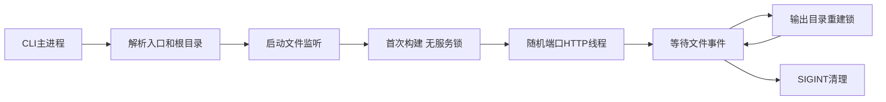
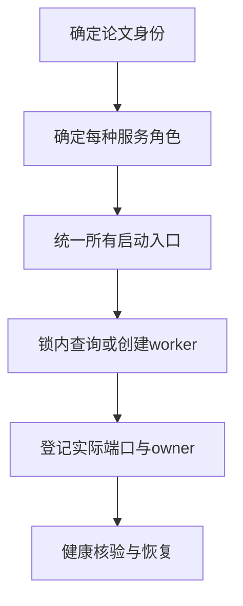

# 本地入口与进程唯一性调查

完成日期：2026-10-13。范围：源码调查与隔离实验。未修改产品源码、真实论文或已有进程。仓库开始和结束的 `git status --short` 均为空。未提交、未推送、未访问发布服务器。所有实验进程均已退出。

## 结论

现有产品没有服务级去重，也没有服务注册表。重复启动同一论文或同一报告可以创建多个监听进程。动态端口使多个入口同时有效。输出目录锁不能代替论文服务锁。

“最多一个”应限定为每个论文身份、每种服务角色的活动服务主进程。监听线程、文件监听线程、翻译任务和编译子进程不计作服务主进程。常驻入口服务是另外一种角色，不应计入论文服务数量。

## 入口清单与发现困难

| 入口 | 行为 | 源码/约定 |
|---|---|---|
| `latex-review-live ENTRY` / `python -m latex_review.live` | 构建当前论文，启动监听和 HTTP 服务 | `pyproject.toml:26`；`src/latex_review/live.py:106` |
| `latex-review-preview DIR` / `python -m latex_review.serve` | 对已有报告启动 HTTP 服务 | `pyproject.toml:27`；`src/latex_review/serve.py:292` |
| `latex-review-preview report.html` | 同上，使用父目录 | `serve.py:276` |
| `latex-review-preview ENTRY.tex` | 从启动目录配置找 output；不从入口推导 output | `serve.py:276-288` |
| `latex-review ENTRY --open-browser` | 生成报告后，在同一 CLI 进程调用 serve.main | `cli.py:512-523` |
| `--open-browser` | 只打开当前服务输出的随机端口 URL | `serve.py:320-332`；`live.py:151-157` |
| report.html 文件链接/双击 | 阅读正文；批注需要本地服务 | `Docs/report-preview.md` |
| 单文件导出 | 另一份可分享报告，内嵌资源与批注 | `delivery.py:220`；`serve.py:66-82` |
| `--upload` 和远程 latest/历史报告 | 静态发布；不依赖本地端口 | `cli.py:496-510`；`Docs/report-upload.md` |

PATH 中的命令是 setuptools 包装脚本。已检查 `/Users/jinghong/miniconda3/bin/latex-review-live`，脚本仅导入并调用 main。仓库 `.venv/bin` 另有入口。仓库没有负责服务唯一性的启动包装脚本。

技能有仓库版 `.agents/skills/latex-review/` 和用户安装版 `/Users/jinghong/.agents/skills/latex-review/`。两者 live 参考当前相同。技能让智能体保存进程或终端会话标识，却没有跨对话查询入口。报告地址只在启动标准输出中。报告目录没有 PID、端口或 owner 记录。`live-status.json` 仅有 revision/message，不证明服务仍存活。

技能 live 参考存在过时内容：它说默认根目录为入口父目录、命令不读项目配置、不提供翻译。当前 `live.py:117-141` 会推导 Git 根目录、读取配置并创建翻译会话。CLI help 的默认根目录描述也落后于 `_source_roots`。这会使智能体选择错误根目录或配置。

同一报告的多入口有两类。目录、report.html、tex 参数是启动参数别名；每次启动都会创建新端口。文件、导出文件和远程发布是不同交付形式，不能都解释为重复服务。

## 生命周期与并发保障

1. live 解析真实入口和根目录，启动 ProjectEvents。
2. live 首次构建输出，再创建 HTTP 服务。
3. live 在主线程等待文件事件；HTTP 服务在线程中运行。
4. 后续构建取得按输出目录命名的 rebuild_lock。
5. SIGINT 触发退出，关闭监听器和 HTTP 服务。



live 默认输出为真实项目根目录的 `.latex-review/live`；自定义 output 会 resolve。默认端口为 0，未提供端口参数。首次构建未取得 rebuild_lock。`_write` 使用固定 `文件名.tmp`，并发首次构建会争用临时文件（live.py:43-47）。live 没有 SIGTERM 处理，默认 SIGTERM 会直接终止进程，不能保证 finally 清理。

serve 默认端口为 0，可指定 --port。显式端口冲突返回 4，但这是端口排他，不是论文排他。serve 把报告目录 resolve 后直接创建 ThreadingHTTPServer。SIGTERM 被转换成 KeyboardInterrupt；SIGINT 和 SIGTERM 均走 server_close（serve.py:313-340）。

差异生成默认 output 相对启动目录为 `.latex-review/latest`（cli.py:348）。不是相对入口。配置、自定义输出、不同启动目录都可产生不同报告目录。`run.json` 等生成清单不是进程注册表。报告生成与服务启动之间没有长期服务锁。

`report_rebuild.py:18-27` 的 flock 位于报告父目录的 `.<name>.rebuild.lock`。它串行化重建，不阻止多个服务。`annotations.py:615-666` 的论文身份锁串行化批注写入，也不限制服务数量。PDF、解析、资源缓存的锁同样不是服务锁。

整篇编译由 compilation.py:142-165 创建独立进程会话。编译可产生多个子进程。PDF 转换、片段渲染及 kpsewhich 也可能创建短命子进程。实验使用纯文本论文，没有显式整篇编译。没有执行全系统进程扫描。

## 可复现隔离实验

运行命令：

```sh
cd '/Users/jinghong/Documents/Code/LaTeX Review'
.venv/bin/python /tmp/latex-review-local-entry-20261013/process-experiment.py
.venv/bin/python /tmp/latex-review-local-entry-20261013/process-distinct-experiment.py
.venv/bin/python /tmp/latex-review-local-entry-20261013/process-identity.py
```

脚本显式设置 PYTHONPATH 指向仓库 src，并设置临时 XDG_CONFIG_HOME。脚本不读取用户翻译配置。它保存自己创建的 Popen 句柄。清理仅向这些 PID 发送 SIGINT，并等待退出。浏览器未打开。HTTP 请求只访问实验输出中的 URL。

| 场景 | 活动主进程 | HTTP | 结果 |
|---|---:|---|---|
| serve 同目录顺序启动两次 | 2 | 两个端口均 200 | 无去重 |
| serve 同目录并发启动两次 | 2 | 两个端口均 200 | 无并发服务锁 |
| live 同论文同输出顺序启动两次 | 2 | 两个端口均 200 | 无去重 |
| live 同论文同输出并发启动 | 1 | 一个端口 200 | 另一进程因 `.tmp` 文件争用返回 4 |
| live 同论文不同输出并发启动 | 2 | 两个端口均 200 | 输出分离仍无论文级去重 |

同输出并发失败不是唯一性保障。错误为 translation-units.json.tmp 的 replace 找不到文件。调度改变可能让两个进程都启动。此次只执行一次同输出并发，未测概率。

证据文件：`process-results.json`、`process-distinct-results.json`、`process-identity-results.json`、对应 process-* 目录的 launch-*.log。10 个实验进程全部退出；9 个退出码为 0，争用失败进程退出码为 4。distinct JSON 的 command 字段记录最终 output-1 参数；脚本实际为第一个进程使用 output-0，第二个使用 output-1。

## 论文唯一标识证据与分支

候选标识优先复用现有批注 project_id 字段：真实 root + 相对 entry 的稳定哈希。依据 annotations.py:145-147。Git 比较通过 worktree_origin 恢复真实论文根目录，避免把临时快照目录当论文身份。内容版本和比较基线不进入 project_id。

| 情况 | 当前证据 | 设计分支 |
|---|---|---|
| 同真实路径的符号链接别名 | live 对 entry/root resolve；实验 real/alias 一致 | 入口统一 resolve，拒绝根外入口 |
| 多主 tex | project_id 包含 entry；各主 tex 身份不同 | “每篇”按主 tex 定义，或增加显式论文注册 ID |
| 不同基线 | annotations 身份不含比较基线；recipe 保存基线 | 单报告服务切换当前报告，或一个服务托管多个报告版本 |
| 同论文不同 checkout | root 不同，身份不同；实验候选键不相等 | 默认 checkout 独立；跨 checkout 合并需显式逻辑论文 ID |
| 同入口不同 --root | 身份字段不同，相对 entry 也可能不同 | 固定注册根目录，或用真实 entry 为服务键 |
| 根目录内入口符号链接 | live resolve 入口；sources Git 模式保留入口路径部分操作 | 统一规范化，避免批注身份与服务身份漂移 |
| 移动目录/替换 inode | 真实路径哈希可变或同路径对应新论文 | 显式重新注册；不能仅依赖 inode 长期身份 |

process-identity.py 只验证路径和候选字段关系，不复刻产品哈希编码。产品 project_id 应直接使用现有字段/算法。未实际创建 Git worktree；checkout 判断由字段与源码支持。

## 遗留进程、崩溃与重启风险

遗留服务没有受信 PID 元数据或控制接口。不能仅凭端口、report.html 或 live-status.json 接管或停止。`/api/report` 能报告目录，但不能证明启动者身份，也不是 stop API。启动新入口服务时，既有 live 仍可继续写同一输出。

迁移宜先保持遗留服务可见但未托管，提示停止后重新启动。若需要自动接管，必须设计身份握手与明确控制协议。不要扫描全部进程后按模糊命令名 kill。

PID 可被系统复用。PID 文件、活跃端口和心跳不能单独证明所有权。服务锁必须覆盖创建、运行和清理；内核锁随崩溃释放。端口登记应在实际绑定后原子发布。重启须验证登记 owner、进程启动标识和协议握手。

服务崩溃后，旧输出及 live-status.json 会保留。固定 `.tmp` 可能残留。现有 live 启动通常会重写输出，但多个启动仍会竞态。入口服务与 worker 若独立存活，入口服务重启必须先核对 worker，避免再启动一份。是否让 worker 随父进程退出，须明确选择。

## 给设计子对话的决策

1. 决定论文身份按 checkout+主 tex，还是显式跨 checkout 论文 ID。
2. 决定差异报告服务如何托管不同基线和历史输出。
3. 决定唯一性保障覆盖哪些入口，包含旧 CLI 直接调用。
4. 决定遗留服务只展示，还是支持显式接管。
5. 决定入口服务崩溃后的 worker 生存策略。
6. 决定注册状态、内核锁与健康握手的职责。



## --upload 隔离要求与限制

当前顺序为生成、上传、启动本地预览（cli.py:495-523）。上传只由显式 --upload 激活。上传入口匹配使用 entry.resolve（upload.py:38）。服务去重不得跳过生成或上传，不得把本地端口身份用于远程 slug。不同基线仍需按原发布逻辑生成 release。

本调查未执行上传、浏览器交互、真实论文、服务强制崩溃或原生 watchfiles 并发压力测试。实验只验证服务数、启动竞态和 HTTP 可用性。生产实现及设计 ADR 留待后续任务。
