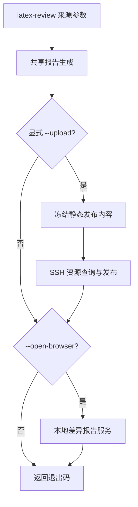

# `--upload` 兼容性调查

日期：2026-10-13。仓库：`/Users/jinghong/Documents/Code/LaTeX Review`。
结论：远程发布不依赖本地服务。常驻本地入口服务必须保持这项独立性。
本调查没有修改产品源码、真实论文、凭据或既有服务。没有连接远程发布服务器。

## 1. 当前路径与证据

下列源码位置均相对于上述仓库。行号对应调查时的文件。

1. `pyproject.toml:23` 注册 `latex-review = latex_review.cli:main`。`cli.py:304` 是唯一产品 `--upload` 参数入口。
2. `cli.py:326–495` 完成来源读取、解析、比较、可选隔离编译、报告生成和运行清单。
3. `cli.py:496–510` 调用 `upload_report`。它从来源选项取得论文入口，并传入有效翻译配置。
4. `upload.py:65–108` 读取上传配置，冻结发布内容，协商资源，传输归档，验证回执。
5. `cli.py:511–527` 只在 `--open-browser` 存在时启动 `serve.main`。上传先于预览。



全仓库 Python 和 shell 检索仅发现上述产品上传调用。`latex-review-live` 没有 `--upload`。
`report_rebuild.py:94–106` 通过 `cli.main` 重建差异报告，但不添加上传或浏览器参数。
`ci.py:62` 通过 CLI 生成报告，也不添加上传参数。
常驻入口不得把重建、发现、注册或刷新转化为隐式发布。

## 2. 配置、生成内容和资源

| 对象 | 当前契约 | 源码证据 |
| --- | --- | --- |
| 上传配置 | `~/.config/latex-review/upload.toml`；绝对 `XDG_CONFIG_HOME` 可覆盖 | `upload.py:16–42` |
| 论文身份 | `Path(entry).resolve()` 匹配唯一注册入口；slug 为小写字母、数字和连字符 | `upload.py:37–42` |
| 服务器地址 | SSH 别名；HTTPS 站点根地址，不允许路径 | `upload.py:29–33` |
| 来源模式 | Git、双目录、双文件沿用 CLI；双目录入口拼接新目录，双文件采用新文件 | `cli.py:499–503` |
| 本地输出 | CLI 共用 `write_report` 或源码降级报告；默认 `.latex-review/latest` | `cli.py:304,419–437` |
| 发布准备 | 读取磁盘 `report.html`、`diff.json`、批注清单与批注存储、可用译文缓存 | `delivery.py:182–218,257–280` |
| 静态正文 | 带静态标记；当前正文引用完整压缩历史备份；不携带图片 Base64 副本 | `delivery.py:73–128,257–268` |
| 发布文件 | `report.html`、`release.json`、页面引用的阅读资源 | `delivery.py:287–309` |
| 阅读资源 | 相对 `assets/`、`previews/`、`pages/`；PNG/JPEG/WebP/GIF/PDF | `delivery.py:28–64` |
| 禁止资源 | 越界路径、缺失资源、符号链接、不支持类型；源码和诊断不发布 | 同上；`tests/test_upload.py:35–55` |
| 限额 | 完整发布最多 200 MiB、4096 文件；增量也检查完整体积 | `delivery.py:278,300` |
| 版本元数据 | 新 release、UTC 时间、来源比较说明；不借用本地服务 ID | `delivery.py:274–277` |
| 翻译 | 有配置仅嵌入验证通过的缓存；无配置保留原译文；不请求翻译服务 | `delivery.py:195–218`；`test_upload.py:134` |

`prepare_publication` 复用交付逻辑，而不是请求本地 HTTP 服务。
它在资源查询前将 HTML 与阅读资源读取为内存字节。后续重试复用同一份发布内容。
它不是整个目录的事务快照。并发重建可能在冻结前造成混合读取。
`publication_html` 还读取共享批注存储，因此“仅打包磁盘 HTML”不足以保持原语义。
本调查未验证原有并发重建行为是否总能保持版本一致。

## 3. 远程协议

| 阶段 | 当前行为 | 源码证据 |
| --- | --- | --- |
| SSH | `ssh -C`、BatchMode、连接超时 15 秒、存活探测、调用超时 300 秒 | `upload.py:45–48` |
| 查询 | `resource-query-v1`；传完整 manifest | `upload.py:68–78` |
| 增量发布 | `publish-incremental-v1`；传完整资源清单及缺少的资源；同哈希只传一次 | `upload.py:80–86`；`delivery.py:287–309` |
| 旧服务器回退 | 只有退出码 1 且精确拒绝文本“此账号仅允许发布报告”时，回退 `publish` | `upload.py:70–76` |
| 补传 | 明确 `missing_resources` 回执触发补传；总发布尝试最多 3 次 | `upload.py:80–94` |
| 回执校验 | 检查 protocol、slug、manifest_id、资源哈希集合及 release | `upload.py:51–62,98–100` |
| URL | 返回 `https://站点/slug/latest/report.html` | `upload.py:108` |
| 接收方 | 接收方锁保护发布与资源；验证后原子切换 latest | `deploy/publish.py:106,142,233–236,255` |

连接失败、异常回执和资源验证失败不会转为旧协议上传。
本地入口服务不得改变 SSH 参数、超时、重试、回退条件、资源 URL 或返回 URL。
当前没有上传 dry-run 参数；调查使用 mock SSH 和临时接收目录。

## 4. 退出码与服务不可用

| 情况 | 当前退出码 | 本地服务 |
| --- | --- | --- |
| 报告生成与上传成功 | 0；报告有有效诊断时仍为 2 | 不指定 `--open-browser` 就不启动 |
| 上传失败 | 16 | 本地报告保留；指定浏览器时仍尝试预览 |
| 上传成功，预览启动失败 | 预览退出码；启动失败通常为 4 | 发布已经完成 |
| 上传失败，预览也失败 | 预览退出码，通常为 4，覆盖 16 | run.json 仍记录上传失败阶段 |
| 配置、来源、内部失败 | 原有 64、4、8 | 上传阶段不执行 |
| 正常停止预览 | 保留报告或上传结果 | Ctrl+C 或 SIGTERM 后返回 |

证据：`cli.py:467–527`、`serve.py:292–336`。
预览启动失败覆盖上传失败，是当前真实行为。不能把它误写成“上传失败必定返回 16”。
本地入口服务不可用时，纯 `--upload` 必须仍能生成和发布。
如仅记录报告失败，也不应覆盖纯上传结果。
对 `--upload --open-browser`，设计必须明确是否保留现有覆盖行为。
如改变命令返回时机或退出码，需作为显式 CLI 契约变更。
现有 `--open-browser` 阻塞到本地服务停止，常驻服务复用后立即退出也属于行为变化。

## 5. 本地单实例限制与批量发布

单实例限制应作用于服务生命周期，不应作用于报告生成或上传任务。
同一论文可重复发布不同来源基线，也可发布不同输出目录。
常驻差异报告服务正在运行时，纯上传也不应启动、停止或替换该服务。
批量发布通常由外部脚本逐篇调用 CLI；产品没有单独批量上传命令。
服务实例键不能作为发布去重键。release 每次独立生成。

尤其不能把纯上传替换为“复用已运行服务的报告”。
这种替换可能发布旧基线、旧源码、旧批注或不同翻译缓存。
也不能把上传变成管理服务队列中的长期作业，否则管理服务不可用会阻断发布。
每篇最多一个差异报告服务，不表示每篇最多一个归档生成任务。
并发写入同一输出目录应由报告生成锁处理，而不是通过取消上传处理。
本调查未执行真正并发发布；重复同一入口实验覆盖顺序批量路径。

## 6. 静态页面与本地路由

静态发布应保留相对阅读资源 URL，不能添加管理服务的 `/papers/<id>/` 前缀。
远程历史页面和 latest 页面都依赖这些相对 URL。
外部 MathJax 依赖继续保留。
静态发布页面没有本地按需翻译能力，但已有译文可读。
批注采用浏览器本地存储，JSON 导入导出保留；独立 HTML 导出隐藏。

证据：`report_translation.js:17–18,206–208`；`annotation_delivery.js:59–69,183–205`。
静态标记禁止本地翻译调用。嵌入正文和备份使批注适配器不依赖本地接口。
脚本中仍存在 `/api/` 文本，不等于发布页面必须使用本地服务。
正常页面运行时的接口选择决定实际依赖。

管理入口如果通过子路径代理本地报告，需要单独解决根路径 `/api/` 调用。
该改动只应影响本地服务展示，不应改写持久报告或发布准备内容。
管理服务使用 `localhost` 或 HTTPS 时，也会触及翻译脚本当前的 `127.0.0.1` 判定。
这些是本地入口设计依赖，不能通过改变远程静态语义解决。

## 7. 已执行验证矩阵

执行环境：仓库 `.venv/bin/python`。测试使用独立临时配置和临时论文。
`tests/conftest.py` 自动隔离 XDG 配置。现有浏览器测试只启动测试服务。

| 验证 | 结果 | 证据文件 |
| --- | --- | --- |
| 归档白名单、路径拒绝、服务端保留与原子切换、配置注册、上传失败后预览、缓存译文不请求服务 | 通过 | `tests/test_upload.py` |
| 增量查询、零资源重复发布、补传、旧协议明确拒绝回退、连接失败不回退、异常回执拒绝、资源回收 | 通过 | `tests/test_incremental_upload.py` |
| 交付资源与翻译缓存契约 | 通过 | `tests/test_delivery.py` |
| 静态发布批注、资源加载、导出限制、压缩备份与坏备份保护 | 通过 | `tests/test_publication_browser.py` |
| 上述现有测试合计 | **46 passed in 30.10s** | `upload-tests.log`、`upload-tests.xml` |
| 上传成功/失败 × 浏览器开/关，以及预览失败覆盖退出码，共六组合 | **6 passed** | `upload-contract-test.py`、`upload-contract.log` |
| 同一入口连续发布三次；mock SSH；禁止 create_server；每次独立 query/publish | **1 passed** | 同上 |
| 自定义隔离实验合计 | **7 passed in 1.05s** | `upload-contract.log` |

复现命令：

```sh
.venv/bin/python -m pytest tests/test_upload.py tests/test_incremental_upload.py tests/test_delivery.py tests/test_publication_browser.py -q --basetemp=/tmp/latex-review-local-entry-20261013/upload-pytest --junitxml=/tmp/latex-review-local-entry-20261013/upload-tests.xml
PYTHONPATH=src:tests .venv/bin/python -m pytest /tmp/latex-review-local-entry-20261013/upload-contract-test.py -q --basetemp=/tmp/latex-review-local-entry-20261013/upload-contract-tmp
```

本调查没有测试线上 SSH、线上登录、线上目录权限或实际远程发布。
已有测试没有枚举所有 CLI 来源模式与 `--upload` 的组合。
本地入口服务尚未实现，所以“入口服务不可用”目前仅由代码依赖和服务禁止 stub 证明。
自定义实验断言 `run.json` 保留上传阶段；没有断言所有预览状态字段。
测试运行前 `git status --short` 为空。调查只写指定临时目录。

## 8. 留给设计对话的决策

| 决策 | 推荐边界 | 后续验证 |
| --- | --- | --- |
| 报告注册 | 纯上传无需管理服务；可选注册失败不能阻断上传 | 拒绝连接、管理服务缺失时实际 CLI 发布 stub |
| 浏览器复用 | 明确返回时机和预览失败退出码；保留上传先执行 | 六组合实验扩展为管理服务集成测试 |
| 单实例身份 | 入口身份只用于服务；来源基线和输出身份保留在报告任务 | 同论文多基线、多目录、跨论文批量上传 |
| 并发重建 | 冻结前共享生成锁；冻结后上传不再依赖目录和服务 | 重建同时准备发布，检查正文、批注和资源一致 |
| 子路径展示 | 本地代理处理根 API；发布资源路径不变 | 对比新旧 PreparedPublication，忽略时间和 release |
| 发现与刷新 | 只发现或刷新本地状态，不自动发布 | 对注册、重建、刷新安装禁止 SSH stub |

推荐把 `upload_report` 和 `delivery.prepare_publication` 留在独立同步发布路径。
生产实现应新增上述集成回归，但本调查没有修改产品代码或 ADR。
