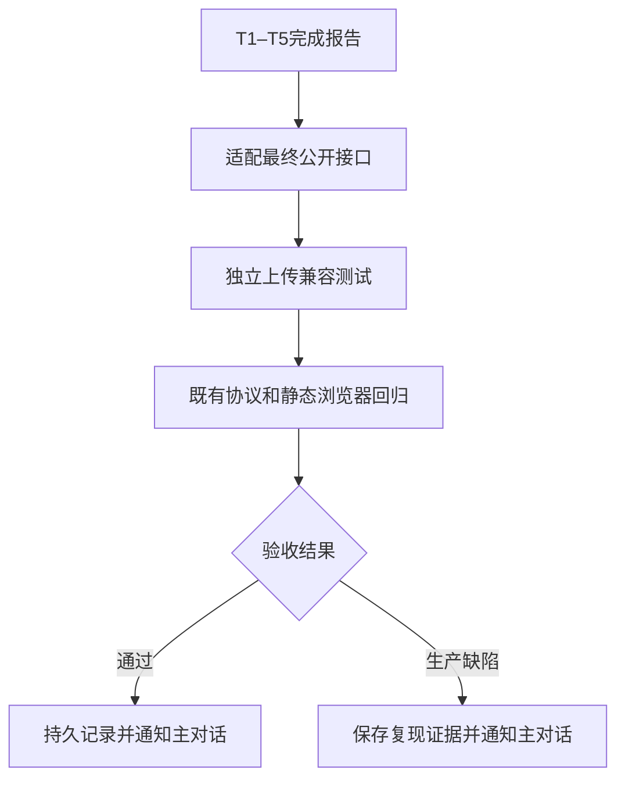

# 本地入口服务：上传兼容验收

日期：2026-10-13。状态：独立上传兼容验收通过。
同一轮完整执行 67 项测试，全部通过。

## 验收边界

远程请求只使用 `_ssh` stub。测试不发布真实报告，不读取真实凭据。
测试使用临时论文、上传配置、状态目录和输出目录。
只终止测试自身创建的子进程。源码修改限于独占测试文件。

验收文件：`tests/test_local_upload_compatibility.py`。
既有设计依据：`design-summary.md` 中 A12–A16 和输出事务边界。
既有基线：`upload-audit.md` 中 46 项发布回归和 7 项隔离实验。

## 已准备的独立检查

| 设计项 | 检查 |
| --- | --- |
| A12 | 入口缺失、状态损坏、端口冲突时纯上传；禁止入口客户端；保留无关监听进程 |
| A13 | 上传和浏览器六种退出码组合；保留报告诊断退出码 2；检查 run.json 阶段 |
| A14 | 同论文三种基线与输出、跨论文发布；每次执行资源查询和发布；release 独立 |
| A15 | SSH 前真实子进程取得输出租约和生成锁；随后替换输出，发布及浏览器仍采用本次冻结正文 |
| A15 | 冻结后替换资源和更新批注；归档仍携带原资源和原批注修订号 |
| A16 | 静态标记、相对资源 URL、压缩批注、无管理路径和管理凭据 |
| 输出事务 | 两个真实 CLI 子进程：同输出串行；不同输出同时进入写入 |
| replay | 真实父进程和 replay 子进程完成重建，没有锁重入死锁 |



## 独立执行记录

先通过 `wait_threads` 确认实施负责人本轮已 completed，并明确报告 T1–T5 完成。
已读取 `implementation-status.md`、`implementation-validation.json` 和最终生产接口。
负责人自己的 620 项回归未计入下列独立结果。

实际命令：

```sh
.venv/bin/python -m py_compile tests/test_local_upload_compatibility.py
.venv/bin/python -m pytest tests/test_local_upload_compatibility.py tests/test_upload.py tests/test_incremental_upload.py tests/test_delivery.py tests/test_publication_browser.py -q --basetemp=/tmp/latex-review-local-entry-20261013/upload-implementation-pytest --junitxml=/tmp/latex-review-local-entry-20261013/upload-implementation-tests.xml
```

结果：**67 passed in 36.57s**。失败 0，跳过 0。进程退出码 0。
其中独占上传兼容文件 21 项，既有发布回归 46 项。
所有文件在最终代码同一轮同时通过，没有拼接不同代码状态的测试结果。
独占文件没有减少测试或跳过失败项。没有修改任何生产源码。

完整日志：`/tmp/latex-review-local-entry-20261013/upload-implementation-tests.log`。
JUnit：`/tmp/latex-review-local-entry-20261013/upload-implementation-tests.xml`。
全部临时论文、状态和子进程日志位于该轮 `upload-implementation-pytest` 下。

## 已验证证据

1. 纯上传禁止 `local_client.endpoint/request/start/ensure/follow/stop`；三种入口状态都不阻断发布。
2. 六种上传与预览组合保留退出码优先级；另外四种诊断组合保留 2、16、4 的优先级。
3. 三个 Git 基线、三个输出和另一篇论文各完成独立资源查询及发布；四个 release 互不相同。
4. 资源查询 stub 内的真实子进程成功取得输出租约和非阻塞生成锁；SSH 前已经释放二者。
5. 该子进程替换磁盘报告后，归档仍含本次冻结正文；浏览器副本也仍含本次正文。
6. 冻结后的资源替换与批注更新没有进入本次归档；归档批注修订号为 1，磁盘存储已为 2。
7. 两个真实 CLI 进程验证同输出串行；不同输出同时进入写报告阶段。
8. 真实父进程调用重建，内部 replay 子进程完成；报告保留基线并包含更新正文。
9. 静态归档不包含入口 token、nonce、稳定链接前缀或管理端口；相对资源 URL 保留。
10. 既有增量发布、补传、精确旧协议回退、异常回执拒绝、服务器保留策略及静态浏览器回归全部通过。

## 生产接入点复核

`cli.main` 持有输出事务直到报告完成。指定浏览器时，事务内先复制本次报告。
`upload_report` 先调用 `delivery.prepare_publication`，随后释放生成事务，再调用 SSH。
`prepare_publication` 取得原有重建锁；同进程嵌套锁由重建锁上下文处理。
`cli` 只在浏览器分支调用 `serve.main`。纯上传不查询或启动入口。
运行清单在上传之后使用本次 run ID 校验，避免覆盖后来生成的报告状态。

源码：`src/latex_review/cli.py`、`upload.py`、`delivery.py`、`output_leases.py`、`report_rebuild.py`。

## 风险与限制

本轮未连接真实 SSH，也未执行线上发布、登录或服务器权限验收。
既有 receiver 测试使用临时服务器目录；浏览器测试使用隔离静态 HTTP 服务或文件。
本轮平台为 macOS；不证明 Linux、网络文件系统或 Windows 的运行结果。
冻结测试通过受锁子进程替换和冻结后更新验证一致性，未使用真实 TeX 长编译与上传竞争。
入口服务生命周期和翻译缓存验收属于另一位独立验收负责人的文件；本报告不替代其结论。
本轮没有运行那份文件，因此不声称两个独立验收文件共同执行通过。

结论：A12–A16 的上传兼容边界，以及相关输出串行、并行和 replay 锁检查通过。
没有发现需要源代码修复的上传兼容缺陷。没有真实远程发布、提交或推送。
