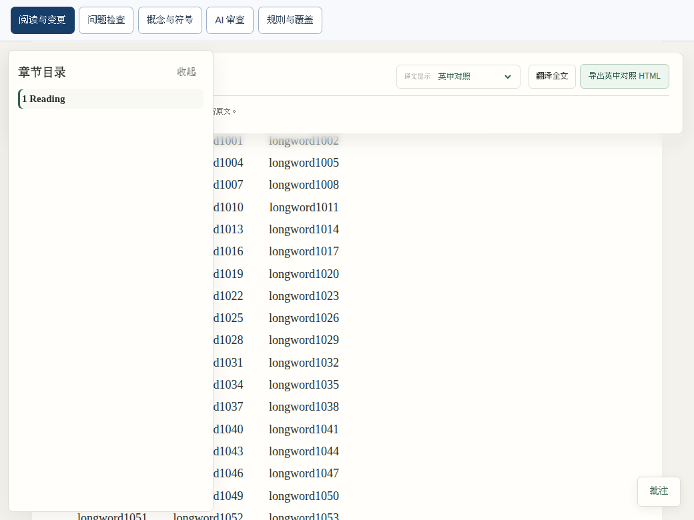
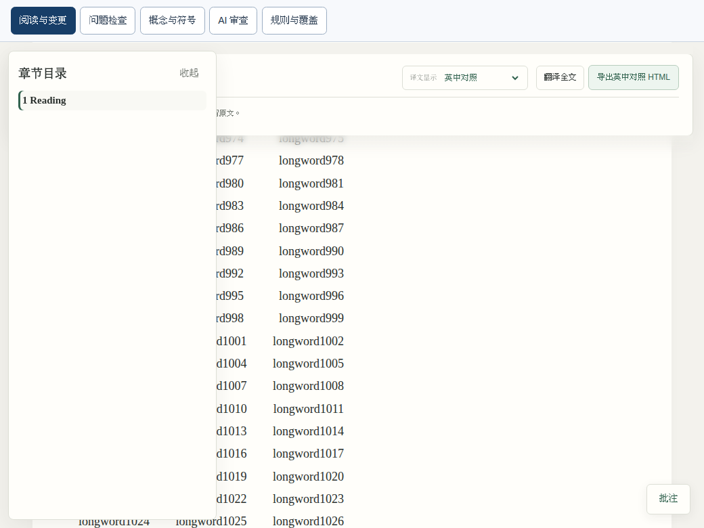

# Initial-frame reading-position guard — controlled actual-app pair

## Scope and provenance

This pair proves a **controlled late-initial-animation-frame defect**, not the exact cause of either historical hosted macOS reading-position failure (407.00894px in live mode or 9743.55920px in standalone mode). Those failures remain unresolved pending new evidence. No timing threshold was relaxed, no font wait was added, and no style or reading layout was redesigned.

Both captures ran the real generated synthetic live reader in Linux Chromium **155.0.8059.39**, at the same 1280×900 initial viewport and **1040×780** final viewport, with the same theme, source paragraphs and saved character. The old application is `b742583254a69dd7103be07b4e5f110f3c4c2c5e`; actual capture HEAD was its application-identical child `becf726dafeba0700ad41db1f0d342b636357e9d`. Git comparisons confirmed the application sources matched before capture.

The After capture used that same HEAD plus the narrowly changed reader script in the working tree, now pinned by application commit **`bdc210440520c9880a6b31869199756969d26cfa`**. That commit contains the exact captured script; it does not change the recorded capture HEAD. Its exact script SHA-256 is `6593383a67d10e5a47f9c8f0e045c92ccb1ef21b42928d3b65470b3976ff0aa4`; Before is `2164d281180128f6e9dc1121152a89ca957e352abb6750b7837e114dec0d541c`. The stylesheet, workspace script and section script hashes are identical across the pair. Capture HEADs and asset hashes are retained rather than rewritten to a later commit.

[Pair summary](pair.json) · [Before state and callback trace](before.json) · [After state and callback trace](after.json)

Temporary fixture paths were omitted from the public state records. Each includes its original private diagnostic artifact's SHA-256, without copying host paths, real papers, credentials or service tokens. The contents are synthetic.

## Controlled scenario and actual result

An external init script delays all initial `requestAnimationFrame` callbacks while allowing native scroll, resize and load events to run. It then registers the held callbacks with native rAF in their **original FIFO order**. It does not reorder callbacks, replace the application's layout logic, or recapture the saved Range.

1. Load the actual live fixture and retain the original 150ms initial wait.
2. Run the original `CAPTURE`, wait the original 100ms, and run `SAVE` once.
3. Resize natively to 1040×780. The held-frame observation after 150ms is retained, even though restoration cannot yet execute.
4. Release the original FIFO and measure the **same Range** after 150ms. Capture the actual application screenshot without additional UI styling.

| Observation | Actual Before | Actual After |
| --- | ---: | ---: |
| Held-frame error (retained) | 292.973219273743px | 292.973219273743px |
| Same-character error 150ms after release | **292.973219273743px — FAIL <3px** | **0.026780726257px — PASS <3px** |
| Final window scroll | 36066px | 35773px |
| Saved character / text offset | `g` / 11809 | `g` / 11809 |
| Saved viewport ratio | 0.33329608938547484 | 0.33329608938547484 |
| Page errors | none | none |

Before, callback 1 is the unconditional initial `remember()`. It changes `isResizing` from true to false without moving the saved character; callback 2 then sees unchanged dimensions and skips restoration. After, callback 1 preserves the earlier anchor and lets the existing layout callback restore it.

### Actual Before — controlled delayed first frame



### Actual After — guarded initial callback



The open overlay sidebar is the same existing UI in both screenshots. This change does not restyle or redesign it. The saved character's position is established by the Range measurements, not guessed from a screenshot.

## Implementation boundary and verification

Only the queued initial capture in [the reader script](../../../../../src/latex_review/reading_position.js) changes: remember only when not restoring and the signature remains unchanged; otherwise schedule the existing layout handler. Immediate capture, the load handler, restoration geometry, scroll behavior and public API are unchanged. The load handler was deliberately **not** guarded: it also performs necessary startup-layout normalization, a separate case not proved by this scenario.

[Scoped regression tests](../../../../../tests/test_reading_position_initial_frame.py) cover:

- The same FIFO scenario using the literal pre-fix initial callback versus the guarded actual callback: old behavior remains wrong; new behavior is strictly below 3px.
- Native resize bursts and a focused native toolbar control, retaining the same Range and control focus.
- Actual callback-byte branch checks for unchanged initial geometry, active restoration and changed geometry. These isolated branch checks are not presented as browser scheduling reproductions.

The [existing reading tests](../../../../../tests/test_reading_position.py) retain their original 150/100ms waits, capture/error expressions, three viewport sizes, native sidebar interactions and strict <3px assertions. Their failure-only diagnostics now print full JSON with distinct original-error and later-context timing rather than relying on pytest's truncated dictionary representation.

One targeted run, with all results retained: **11 passed / 2 report-only skipped / 25.04s**. See the [raw test output](targeted-tests.log). That selection is not a full-suite or macOS result. Subsequently, the same pinned UI script passed the full Linux mandatory-browser suite (1562 passed / 19 skipped, 696.89s) and both macOS functional workflows at documentation HEAD `48221a0` (1557 passed / 24 skipped each, PR 733.37s / push 744.85s). The controlled pair and successful runs do not explain or close the historical hosted failures; the requester's independent physical-Mac comparison is separate.

## Portable reproduction

[Probe](probe.py) · [FIFO delay instrumentation](fifo-delay.js)

Use an installed checkout with its normal test and browser dependencies. Run once per requested source state and use a fresh output directory; the probe refuses to overwrite captures. It executes the **current** renderer unchanged and records its script hashes. It does not manufacture a Before source revision.

```sh
LATEX_REVIEW_BROWSER=/path/to/chromium python \
  Docs/design/writing-check/evidence/reading-initial-frame/probe.py \
  --output /your/new/synthetic-output --phase after
```

No real paper, translation provider, TeX compilation, live service, performance benchmark, latency profiling, N10 run, deployment or merge is involved. The owner's performance-work hold remains in effect; this evidence concerns only the separately authorized UI correctness task.
