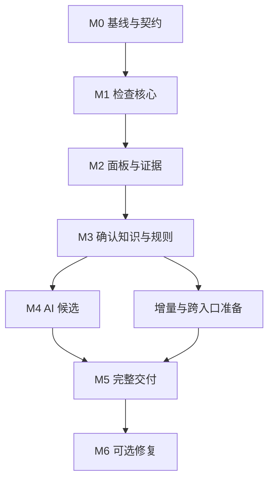

# LaTeX-Review 论文写作检查扩展 · PLAN

版本：1.0 · 日期：2026-11-05（北京时间）  
规格：[SPEC](spec.md)  
基线：`main@fe82620af8bbbb028809d59ceeaaad7085427880`  
建议归档位置：`Docs/design/writing-check/plan.md`，与 `spec.md` 同目录。

**实施顺序：先把现有规则整理成可检查当前论文的核心，并接入实际面板；随后建立作者确认的知识索引，最后增加受约束的 AI 候选审查。** 每个阶段均有可展示、可验收的结果，不等全部完成后才交付界面。

本文件是开发计划，不是已完成记录。本轮仅核查代码并编写设计，没有运行应用或测试，也没有创建 Issue、提交代码或修改已安装工具。命令示例中新增的 `latex-review-check` 尚不存在。

## 1. 已确定的实现取舍

| 决策 | 本轮采用 | 原因/影响 |
| --- | --- | --- |
| 产品载体 | 扩展 LaTeX-Review 的工作台与阅读页 | 保留既有阅读、差异、翻译、批注及历史体验 |
| 面板数量 | 阅读与变更、问题检查、概念与符号、AI 审查、规则与覆盖，共五个 | 阅读区承载正文，其余是可切换视图；证据抽屉共用 |
| 解析实现 | 复用 `sources → structure → ParsedProject` 和 `SourceMap` | 不先更换解析器；先修复实测缺口 |
| 数据契约 | 新 `checks.json` 1.0 与独立 Schema | 避免将新状态塞入旧 `diff.json` 1.1；主变更计数不改 |
| 知识格式 | 一个权威 JSON 文件；界面管理；TOML 配置 | 不引入 YAML 依赖和双重权威来源 |
| UI/服务 | 原生 HTML/CSS/JS；现有本地入口协调任务 | 不引入前端重写、Web 框架或第三种阅读服务 |
| 规则与 AI | 确定性核心先上线；AI 可选且仅产生候选 | 无密钥也可用，语义错误不会直接污染知识 |
| 修改正文 | 新检查功能首版不自动写正文 | 复用已有批注关联；批量修复另与 #53 衔接 |
| 增量实现 | 首先全量确定性检查+增量结果，随后按依赖优化 | 保证跨章节改名/删定义不漏检，避免过早构建复杂增量解析 |
| 操作环境 | macOS 首要验收，Linux 回归 | 与仓库范围一致；原生 Windows、Markdown 和 LSP 延后 |

实施无需再为这些常规取舍等待确认。若真实项目存在无法支持的宏或性能瓶颈，先以降级状态保障正确性，再提交有证据的局部设计调整。

## 2. 里程碑与依赖

| 里程碑 | 主要交付 | 用户可用能力 | 退出条件 |
| --- | --- | --- | --- |
| M0 基线与接口冻结 | 基线记录、回归结果、契约草案、真实论文支持清单 | 不改变当前应用 | 明确已有失败/缺口；不把旧失败归到新功能 |
| M1 当前论文检查核心 | 一致快照、单版本规则、checks.json、基础 CLI | 无浏览器/无 AI 检查当前论文 | 基础检测、定位、覆盖及旧契约回归通过 |
| M2 五面板工作区 | 导航、问题清单、证据抽屉、覆盖面板、任务通道 | 浏览器可完整查看基础问题并跳到原文 | live/diff、旧报告、静态/历史行为正确 |
| M3 知识与确定性一致性 | 登记/确认、角色作用域、术语/缩写/有限符号规则 | 达到 P0：实际写作时可持续使用 | 无 AI 完成闭环；作用域和并发验收通过 |
| M4 受约束 AI 审查 | 候选队列、证据校验、导入/导出、可选模型调用 | 发现隐式关系和潜在跨章节矛盾 | 非法证据/陈旧结果无法进入当前知识 |
| M5 增量、跨入口与交付 | 依赖失效、多入口汇总、导出、迁移与性能验收 | 达到 P1：完整日常写作工作区 | 全链路、两平台范围声明及兼容验证完成 |
| M6 可选后续 | 建议补丁、#53 多处应用、LSP 等 | 从检查延伸到明确的修复辅助 | 另立范围；不阻塞 M0–M5 |



M3 是第一个正式日用版本；不能为追求 M4 的语义效果推迟它。M4 与 M5 中独立的准备工作可分开推进，但共享契约和知识写入逻辑的变更应顺序合入。此处是任务依赖设计，不要求使用多 Agent。

若用于排期，可先按单名熟悉 Python/原生 JS 的开发者估算：M0 1–2 天、M1 3–5 天、M2 3–5 天、M3 5–8 天、M4 5–8 天、M5 3–5 天，总计约 20–33 个工作日。此为规划估计，包含必要测试，不是项目实测速率；M0 后据解析缺口修订，不通过删掉验收压缩时间。

## 3. M0：核对当前代码，冻结最小契约

### T0.1 基线核对

读取 `AGENTS.md`、`CONTEXT.md`、`Docs/adr/` 和相关开放 Issue；目录以实际 `Docs/` 大小写为准。确认 HEAD 是否仍为本文基线，逐项核对 #50 与 #53 实现状态。

仓库使用 GitHub Issues 管理规格；如本次实施工作另有发布授权，可将已确认规格和任务关联到对应 Issue。用户仅索要文档时不自动发布工单，也不把发布工单设为本地实现前置条件。

安装项目测试依赖，按实际平台运行已有验证入口：

```bash
python -m pip install '.[test]'
python -m pytest
# macOS 上按仓库实际脚本运行完整平台验证
./scripts/verify-macos.sh
```

记录 Python/操作系统/依赖版本、测试命令和退出码。Playwright 浏览器依赖与 TeX 可选依赖分别记录；因环境缺失跳过不算通过。不要把历史提交消息中的测试数字当作本次结果。

### T0.2 小型验收论文

新建 `tests/fixtures/writing_checks/`，覆盖多文件、重复包含、正文/摘要/附录、图表、普通与复杂公式、UTF-8/CRLF 和只读配置。采用小而有辨识力的案例，不为每个 getter 写测试。

同时选一篇作者真实论文作本地验收；不得把其私有正文提交到工具公开仓库。先列出入口、宏、引用命令、解析降级及已知问题。真实论文暂不可用时仍可完成合成夹具开发，但最终记录“真实论文验收未完成”，不虚构成绩。

### T0.3 数据契约草案

冻结以下最小对象及 Schema：`CheckInput`、`CheckReport`、`Finding`、`SourceEvidence`、`RuleCoverage`、`KnowledgeRegistry`、`SemanticRequest/Response`。AI 契约此时只定义边界，不实现调用。

建议类型接口（签名为设计示意，不要求照抄函数名）：

```python
capture_snapshot(source, configuration) -> ContentSnapshot
build_check_document(snapshot, parsed_project) -> CheckDocument
evaluate_current(document, knowledge, rule_set) -> CheckReport
compare_reports(previous, current, comparability) -> CheckDelta
validate_candidate(request, response, current_input) -> CandidateValidation
```

约定 `checks.json` 保存稳定排序的逻辑结果，运行时间、耗时、费用和 run_id 放 SQLite/运行元数据。问题身份不能只由行号或当前节点 ID 构成。概念 ID 由注册时分配并持久保存，不随显示名变化。

### T0.4 确认接入点

输出 `Docs/design/writing-check/baseline.md`：已读文件、真实基线、受支持语法、已知失败、性能基线、需要改动的模块和 #50/#53 协调结论。这是实现阶段新增的工程记录，不是本轮已交付的第三份文档。

**M0 验收：** 契约字段和身份语义无冲突；现有规则统计与退出码已记录；不会把新功能暗中塞入不兼容字段。

## 4. M1：可独立运行的当前论文检查

### T1.1 一致内容快照与检查视图

在 `checks/snapshot.py` 与 `checks/document.py` 包装现有来源读取和解析对象：

- 读取前后核验依赖内容；变化则有限重试，失败返回 `source_changed`。保留原文件字节哈希与未归一化文本。
- 快照 ID 纳入入口、依赖内容、宏/来源配置及解析模型版本；未跟踪但被引用的文件必须纳入。
- 对缺失依赖记录其路径及范围状态，后续文件出现能触发失效。
- 保留 `origins` 全片段、包含实例和阅读序位；不复用 `ReviewNode.id` 作为永久身份。
- 从可定位的正文单元构建规则文本视图，必要的格式剥离必须带分段映射；没有精确映射只允许显示不确定位置。

在证据单元复用已有 `annotation-content.json` 时，使用其真实 `source_span`，不拿 UTF-16 展示偏移切 Python 字符串。检索可用规范化文字，证据提交回到不可变原文。

### T1.2 拆分现有规则

当前 `rules.py` 的 `_findings(project)` 已包含单侧逻辑，但属于私有实现；将其整理成明确的单侧规则入口，保留原 `check_rules(old,new)` 作为兼容适配器。

边界：

1. 标签、文献键、图表引用规则调用一次单侧扫描，避免 live 和 diff 分别复制代码。
2. `equation_number_changed/unknown` 仍是双版本能力；单版本不得虚构比较对象。
3. 保留参考文献可靠性门控，新增按规则覆盖状态。负面结论需要完整适用范围；积极证据如确定的重复标签仍可按支持范围报告。
4. 现有双版本 `new/existing/resolved` 继续按兼容协议输出；新增检查结果使用独立 delta 状态。
5. 不改变原 `latex-review` 退出码、主变更计数或旧 JSON schema。

### T1.3 结果与运行存储

实现 `checks/model.py`、JSON Schema、稳定排序和摘要。SQLite 表建议：

| 表 | 保存内容 | 约束 |
| --- | --- | --- |
| `runs` | paper_id、input_id、状态、范围、时间、错误、版本 | 只有完整匹配输入的结果可设为当前 |
| `finding_instances` | 某次运行的问题及证据、逻辑 finding_key | 不覆盖旧运行；人工判断通过独立记录关联 |
| `candidates` | AI/启发式候选和验证状态 | 与已确认知识隔离 |
| `events` | 决定提交、失效、重试、取消和迁移事件 | 知识文件是决定的权威源，此表是审计投影，不反向覆盖文件 |

SQLite schema 需有版本和事务迁移；复杂知识关系先在 JSON/内存索引中查询，不先构建图数据库。缓存与持久运行状态分开目录，不能随候选报告目录替换丢失。

### T1.4 CLI

在 `pyproject.toml` 增加 `latex-review-check`，支持 `run/query`，先完成 `--all` 和可诚实回退全量的 `--changed`。退出码、输出路径和内容遵守 SPEC API-02；未知参数不得静默忽略。

`--changed` 首版可以扫描全篇，但必须输出 `evaluation_mode=full`、比较基线和回退理由，不能宣传已做增量解析。无基线的首轮结果为 not_comparable。

**M1 验收：** AC-01/02/03/09/10/20/21/23；关键用例重复运行得到同一规范化结果。无 AI、无 TeX、无浏览器可完成基础检查。

## 5. M2：工作区面板与证据定位

### T2.1 共用工作区装配

在 `reading.py` 的共享入口装配面板，live/diff 保留各自正文和版本视图。`local_dashboard.html` 仅增加检查摘要和打开入口；不把全局服务管理改成论文编辑器。

首个 UI 切片需真实贯通“运行当前检查 → 显示问题 → 原文定位”，其余未完成面板显示明确空态。禁止用假问题数据展示成真实扫描结果。

建议新增文件：

| 文件 | 职责 |
| --- | --- |
| `review_workspace.js` | 面板导航、能力探测、URL 状态、焦点/阅读位置恢复 |
| `review_checks.js` | 检查清单、过滤、分页、运行状态与共享证据抽屉 |
| `review_knowledge.js` | M2 提供空态与选择入口，M3 实现编辑/确认 |
| `review_semantic.js` | M2 提供禁用态，M4 实现候选与任务 |
| `review_workspace.css` | 面板布局、证据排版、响应式与键盘焦点 |

所有新静态资源加入包数据清单及单文件报告装配；不要仅在开发环境通过磁盘路径加载。

### T2.2 调整服务与生命周期

本地入口的检查协调器管理短任务，沿用两类阅读服务槽位。新增路由在独立处理模块中分发，避免继续膨胀 `local_service.py`。

- 活动论文页面通过工作进程 `/api/checks/...` 桥接访问本地入口的规范 API。
- 检查页面纸面身份/版本、论文令牌及已有 Origin/Host 规则；内部调用使用 `local_client`，不把入口令牌暴露给浏览器。
- CLI 与 UI 共用 Runner/Store；无入口服务时 CLI 可在同样的跨进程锁下运行。
- live/diff 同 paper_id、同 input_id 的请求可复用结果；不同版本不可合并。
- 任务单独记录状态，不能用“阅读服务 ready”替代“检查成功”。重启时未完成任务标记 interrupted。

令牌和代理只在活动本地服务中使用。静态 HTML 和历史 HTML 内嵌冻结结果，不携带可用写令牌，也不通过页面数据推导绝对路径。

### T2.3 问题去重与导航

为旧 `Diagnostic` 和 `Finding` 增加 display adapter：统一规则键可合并显示，其详细证据保留。未知宏/渲染诊断进入覆盖或预览分类，不误归为作者写作错误。

证据点击使用已有阅读单元与原文定位；无法构造可靠 DOM 选区时显示完整原始片段及文件位置，不能随意高亮相似句。跨章节候选在 M4 使用同一抽屉。

### T2.4 只读、历史和旧报告

旧报告没有检查清单时提供空态。历史报告只显示冻结的 check snapshot；不能读取当前注册表填补旧结果。导出静态报告仅具备检索与阅读，不发出检查/知识写入请求。

**M2 验收：** AC-03/19/22；live/diff 两条端到端浏览器路径通过；代理路径、直接工作进程和静态页面的能力不同但表述清楚；键盘焦点与滚动不退化。

## 6. M3：作者知识与确定性一致性检查

### T3.1 知识注册表

实现唯一激活的 `.latex-review-knowledge.json`，包括 schema_version、revision、概念、符号绑定、确认关系、决定、例外。P0 不强制填满所有字段，支持从一个概念起步。

存储接口包含读取、校验、条件写入、导入预检、导出、撤销决定和备份恢复。`expected_revision` 与内容哈希同时校验，捕获手工编辑后 revision 未改变的情况。项目级跨进程锁覆盖多个入口；知识写入临时文件+原子替换，运行数据库只保存投影。

扩展 `cli._config`、全局配置白名单与 `project_profile.validate`。只读项目使用应用状态目录；检测到 project 存储不允许写入时应提示修正，不偷偷创建文件。

### T3.2 概念与符号面板

可从阅读选区创建概念，填写正式名称、允许名称、禁用名称、适用范围、代码映射；右侧显示全文出现列表。用户可把出现标为预告、定义、正式使用、例子、引用或未知。

符号子页按作用域展示绑定；同符号不同作用域并列，而非全篇去重。确认新的别名关系需显示双方证据；合并两个概念时列出受影响规则和冲突，不把确认关系等同于自动全文替换。

### T3.3 规则分批上线

| 批次 | 功能 | 先决条件 | 首个验收案例 |
| --- | --- | --- | --- |
| A | 禁用名称与代码标识符 | 确认的名称政策、可定位正文视图 | 同一词出现在正文、注释、代码示例，只有政策范围内命中 |
| B | 缩写引入 | 已知映射、支持的显示/使用宏或明确文本模式 | 摘要与正文独立首次展开；仅声明不能算正文引入 |
| C | 定义/依赖顺序 | 确认角色、定义组、入口顺序、强依赖 | 定义后移，未修改章节的正式使用也被检测 |
| D | 有限符号绑定冲突 | 确认绑定与作用域 | 局部复用合法；同域冲突提示；未知绑定留待审查 |

每批同时增加违规和合法对照案例。暂不自动理解任意数学符号作用域；为未知对象提供候选/待登记，不用“出现早于字符串定义位置”代替语义事实。

对新支持的 LaTeX 宏编写显式适配表及规则前置条件，至少区分引用宏、术语声明宏、首次使用宏。`\cref{a,b}` 的多键语义必须与普通 `\ref{a,b}` 分开。

### T3.4 决定、例外与重新检查

区分“这是问题”“这不是问题”“本处允许例外”“以后不运行该规则”。局部例外带位置/作用域和有效条件；规则变化或锚点歧义后标记待复核。

知识变化立即让受影响结果过期，随后重新扫描。已解决状态只能由有效检查推导。转批注只创建关联记录，不写正文、不自动解决问题，也不自动把所有问题批量写成批注。

**M3 验收：** AC-04/05/06/07/08/12/17/18/24；完成一篇真实论文或已明确记录缺失的真实验收；正式形成 P0 发布记录。

P0 演示脚本：在方法定义处登记模块 → 在实验章节写入禁用别名 → 保存 → 问题面板定位 → 手工改回 → 复检显示已解决 → 查看例外与覆盖。全过程不需要模型接口。

## 7. M4：受约束 AI 候选审查

### T4.1 先建验证器，再接模型

先实现 request/response 契约、证据单元白名单、逐字验证、版本校验、候选存储与导入；使用固定模拟响应验证，不先花费模型调用去调 UI。

检验：编造证据、重复 quote 歧义、越界偏移、未知概念 ID、类型错误、过大响应、缺上下文、拒绝回答、截断 JSON、有效证据但错误推理。前七类应由程序阻断/降级；最后一种必须仍可由作者拒绝，不能因 Schema 通过而变为确定问题。

证据单元优先使用原始源码或有映射的展示文本；标注 `representation`，模型引用哪种文本就在哪种不可变单元中校验。模型给出文件路径/行号的自由文字不能成为跳转依据。

### T4.2 外部 AI 工作流

先交付 `semantic export/import`：导出请求包、允许的任务、知识摘要、证据单元；响应导入走同一验证器。这样作者可以利用已有 AI 写作工具，无需立即配置新的 API。

请求包不包含密钥、绝对本地路径或未选择的文件。响应属于不同论文/入口/版本时拒绝；未知请求不能直接成为确认知识。导入结果必须显示有效、无效、过期项数量。

### T4.3 内置调用

在 `checks/semantic/` 中实现独立调用器。最初可复用翻译配置的解析方式和 HTTP 连接安全原则，避免把翻译专用保护占位符/缓存格式硬用于审查。

若抽取公共 HTTP client，先确保翻译回归不变；若收益不明显，保留小型独立适配器。不能为了架构整洁大范围重写现有翻译模块。

实现显式启动、任务预算、并发上限、超时、取消、有限格式修复、用量记录、缓存及晚到响应处理。成本上限缺少计价信息时以 token/请求额度约束，不估算为零。

### T4.4 候选任务与面板

按 SPEC 三类任务顺序交付：概念/定义候选 → 名称关系 → 跨章节描述对比。初始上下文用已确认概念、章节和关键词检索，不引入向量数据库；确有召回不足再评估嵌入检索。

跨章节问题必须比较限定条件：2D 与高维、训练与推理、算法设置与消融、假设与实验范围、时间版本。模型可返回 evidence_insufficient 或 missing_context，不要求每对文本都产生问题。

AI 面板并列展示证据、理由、缺失信息，提供同一概念/不同概念、确有问题/判断不成立、暂不决定等对应操作。关系确认写知识，问题确认写决定，两者不能共用一个模糊“接受”按钮。

### T4.5 有限人工质量评估

用一份不随调参反复修改的人工案例清单覆盖不同任务，至少包含明确矛盾、限定条件不同但不矛盾、同义与近义但不同概念、缺上下文四类。保存模型/提示词版本、调用预算、候选数、作者确认率、错误类型与审查耗时。

不为该工具组织论文级算法对比、消融或追求一个统一 F1。AI 上线门槛是证据验证与权限边界全部通过，并有人工样例证明其能提供有用候选；候选噪声过高时收窄任务，不通过提高措辞确定度掩盖质量。

**M4 验收：** AC-13/14/15/16；模拟供应商故障测试通过；显式启用后进行少量真实调用，未调用时不得宣称真实接口通过。P0 在 AI 配置错误、断网和取消时继续正常工作。

## 8. M5：增量、跨入口、迁移及完整交付

### T5.1 依赖失效

构建最小内存/SQLite 索引：文件→包含实例→单元；概念→定义/使用；符号→作用域绑定；规则→所需事实。依赖图必须有版本，不能混用旧索引。

首先确保输出语义与全量检查一致，再优化扫描范围：

- 标签/引用等廉价全局索引继续完整更新。
- 定义移动、删除或章节重排影响其全部使用位置。
- 词表变化重新搜索旧词和新词，不能只查询已命中对象。
- 未知宏、包含图、解析器版本变化无法确定闭包时回退全量。
- 语义候选可按关系缩小上下文，但 UI 显示实际选择范围，并保留手动全文语义审查。

用“同一次变更，增量结果与全量结果一致”作为有效测试，针对删除/重命名/跨章节依赖设计案例。不能用仅修改一行普通正文的速度测试证明完整性。

### T5.2 多入口与版本比较

多入口共享术语身份，独立解释定义域、符号作用域和阅读顺序。相同文件在两个入口出现时有独立出现实例；报告汇总可按原始证据关联，但不能丢掉入口上下文。

对比旧新正文时，默认使用同一套当前规则和知识分别评价两侧，以隔离正文变化影响。知识锚点在旧版本无法可靠重定位时，该规则标记 not_comparable。若比较两次历史检查且规则/知识不同，显式说明配置变化，不默认为修复/新增。

### T5.3 导出与历史

检查导出为冻结 JSON/HTML，包含输入摘要、覆盖、当前问题、作者决定和所选 AI 候选。与现有报告目录装配、`delivery.py`、单文件报告和上传流程协调；若 `checks.json` 增加到打包清单，采用显式允许列表。

正文快照产生时只纳入与当时内容/知识版本匹配的检查结果。单独运行检查不额外生成正文快照，避免破坏每篇 20 份快照的既有行为。知识导出独立，不随报告发布隐式泄露代码映射和全文例外记录。

### T5.4 迁移与回滚

| 场景 | 行为 |
| --- | --- |
| 旧项目首次启动 | 不强制新建知识文件；基础检查可用；作者首次保存知识时创建 |
| 旧报告没有检查数据 | 保持阅读；显示未附带检查结果 |
| 新版读取旧 checks schema | 经显式迁移或只读展示；未知主版本不能盲读 |
| 知识文件与外部副本并存 | 显示当前激活源，导入先预览冲突，不自动合并 |
| 降级回旧应用 | 原报告和原批注仍可读；新增文件保留，不要求旧版认识它们 |
| 状态迁移失败 | 保留原数据库/知识备份并明确失败；不继续写入半迁移状态 |
| 移动/克隆论文 | 新根路径产生新 paper_id；可导入知识，但重新校验锚点，不直接复用本机服务状态 |

### T5.5 性能与验收发布

在记录的参考机器上测冷检查、热检查 p95、500 条问题的面板响应、保存时的任务排队，以及原有阅读/翻译启动性能。性能目标见 SPEC NFR-01，不能将 TeX 编译和远程模型延迟混入确定性核心成绩。

最终执行真实论文流程：日常保存 → AI 工具改一章 → 看本次问题和全文关联 → 确认候选 → 手工修改 → 复检 → 提交前全入口检查 → 导出冻结报告。记录失败/跳过范围；没有全部覆盖时仍可交付工具，但必须如实显示覆盖缺口。

**M5 验收：** 全部 AC 条目有结果；P1 完成；新旧格式兼容、只读边界、模型预算、增量完整性与恢复行为有可复查证据。

## 9. 现有文件改动清单

下表列的是预计接入点，不表示必须一次性重构这些文件。实施时按真实 HEAD 修订。

| 文件/模块 | 计划变化 | 必须保留的行为 |
| --- | --- | --- |
| `rules.py` | 提取单版本结果；双版本兼容适配 | 基础规则含义、证据、文献来源门控 |
| `structure.py`、`source_map.py`、`sources.py` | 优先以适配器复用；只为已证实的缺口作局部扩展 | 原文、origin 多片段、包含实例和未知来源语义 |
| `cache.py` | 按需扩展解析/检查版本键 | 宏支持变化失效；不直接共享不兼容序列化 |
| `live.py`、`report.py`、`reading.py` | 接入工作区和检查结果 | 现有正文、差异、翻译、批注装配 |
| `report_directory.py` | 候选输出写入和发布时点协调；核对 #50 | 原子切换、失败保留旧报告 |
| `local_service.py`、`local_client.py` | 新检查协调器与规范路由 | 两槽位、唯一性、稳定入口、进程所有权 |
| `serve.py`、`local_security.py` | 工作进程桥接及能力信息 | 原有令牌、Host/Origin、历史只读边界 |
| `local_dashboard.html`、`local_report.html` | 工作台摘要/进入检查，维持稳定链接 | 论文管理、故障恢复、阅读框架 |
| `report.css` 或新增样式 | 五面板、共享抽屉、窄屏 | 原阅读布局、可访问性和滚动恢复 |
| `cli.py`、`project_profile.py` | 新配置区校验、只读路径策略 | 原 CLI 参数及配置合并含义 |
| `translation.py` | 可选抽公共 HTTP 层；不复用语义结果格式 | 翻译提示、占位符校验、缓存、用量/取消 |
| `annotations/`、`report_rebuild.py` | 首版仅问题关联批注；后续精准建议 | 版本/原文/哈希校验和只读拒绝；#53 另协同 |
| `local_history.py`、`delivery.py`、`upload.py` | 匹配版本的冻结结果打包 | 不回灌旧历史、无凭据导出、上传路径可独立运行 |
| `agent_tools.py`、`run_manifest.py` | 按需暴露检查入口和产物关联 | 旧查询/接受记录语义与原退出码 |
| `pyproject.toml` | 新 CLI、包内资源与 schema 声明 | 第一版不新增运行时服务框架 |
| `CONTEXT.md`、`Docs/` | 增补检查、候选、知识、覆盖术语及指南 | 不把“问题”改称“主变更”，不改旧术语含义 |

建议新增 `src/latex_review/checks/` 与 `src/latex_review/schemas/checks.schema.json`、`knowledge.schema.json`、`semantic-request.schema.json`、`semantic-response.schema.json`。模型与 API 都必须使用同一套契约校验，避免前端接受、后端拒绝的双标准。

## 10. 测试策略与需求追踪

### 10.1 需要增加的测试

| 测试文件（建议） | 检验内容 | 关联验收 |
| --- | --- | --- |
| `test_check_snapshot.py` | 读取一致性、Unicode/UTF-16、CRLF、多来源与包含实例 | AC-09/10/20 |
| `test_check_rules.py` | 当前规则、旧适配、来源门控、问题分组及覆盖 | AC-01/02/03/23 |
| `test_check_registry.py` | 知识校验、原子条件更新、手工编辑、撤销和外部存储 | AC-12/17/18/24 |
| `test_check_terminology.py` | 正文上下文、别名/代码名、缩写 | AC-04/05/07 |
| `test_check_introductions.py` | 定义角色、引言预告、紧邻解释组、依赖顺序 | AC-06/11 |
| `test_check_symbols.py` | 确认绑定、嵌套作用域和合法局部复用 | AC-08 |
| `test_check_semantic.py` | 输出契约、证据、预算、拒绝/部分失败/取消/晚到结果 | AC-13/14/15/16 |
| `test_check_incremental.py` | 变更与全量结果等价、删除/重命名、规则变化 | AC-11/12/20/21/23 |
| `test_check_service.py` | live/diff 协调、重启、冲突、令牌和代理边界 | AC-15/17/18/19 |
| `test_check_workspace_browser.py` | 五面板、定位、分页、键盘、滚动和只读历史 | AC-03/19/22/24 |
| `test_check_export.py` | 冻结数据、旧格式、敏感字段排除和知识导出边界 | AC-18/19/21 |

名称可按仓库风格调整，测试必须围绕真实失败风险，不机械镜像函数结构。确定性测试断言问题集合、证据和覆盖，不只断言数量；语义单元测试用固定响应，不依赖在线模型随机行为。

### 10.2 重点既有回归

- 规则与定位：`test_issue38.py`、`test_structure_preview.py`、`test_sources.py`、`test_contract.py`。
- 阅读/服务：`test_live.py`、`test_live_diagnostics.py`、`test_local_workbench.py`、`test_local_service_acceptance.py`、`test_local_security.py`。
- 历史与发布：`test_local_history.py`、`test_local_history_browser.py`、`test_publication_browser.py`、`test_report_directory.py`。
- 批注/翻译：相关 `test_annotations*`、`test_annotation_suggestions*`、`test_translation*`、`test_live_translation.py`。
- 前端：章节、搜索、页内导航、阅读位置以及当前报告交互测试。

每个提交先运行相关小集合；阶段结束和发版前运行完整集合。已有失败和新增失败分开报告；通过后除非又修改相关代码或出现新疑点，不重复无目的运行。

### 10.3 需求—阶段映射

| SPEC 要求 | 首次实现 | 完整验收 |
| --- | --- | --- |
| UX-01–04，FLOW-01–04 | M2/M3 | M5 |
| DATA-01 文档快照与坐标 | M1 | M5 |
| DATA-02/03 知识与存储 | M3 | M5 |
| DATA-04 结果与身份 | M1 | M5 |
| RULE-01–04 | M1/M3 | M5 |
| AI-01–04 | M4 | M5 |
| INC-01/02 | M1/M2 先保证正确 | M5 |
| ARCH-01，API-01–03 | M1/M2/M3 | M5 |
| COMPAT-01 | M2 | M5 |
| NFR-01 | M0 建基线，各阶段维护 | M5 |

## 11. 关键风险与处理

| 风险 | 可观测信号 | 处理方式 |
| --- | --- | --- |
| 真实论文宏超出解析支持 | 未知宏、缺依赖、源映射降级 | 展示覆盖盲区；先添加明确宏适配，不能用 LLM 猜源码结构 |
| 定义/作用域推断误报 | 预告、where 说明、局部变量反复被报错 | 收窄确定性条件，改为候选或作者角色标注 |
| 语义调用变成全文聊天 | 输出无证据、笼统结论、修改建议越界 | 固定任务/输入单元/Schema，宿主拒绝不合约结果 |
| 知识维护负担过大 | 用户必须登记大量对象才能开始 | 基础规则零配置；优先核心概念；候选分批确认 |
| UI 和数据状态混淆 | AI 候选、确认、已解决、忽略计数相互覆盖 | 分离来源、判断、处理状态、生命周期与版本差异 |
| 增量遗漏全局影响 | 删定义/改名称后未改章节仍显示通过 | 必须与全量结果对照；未知影响回退全量 |
| 双入口/双窗口丢更新 | 知识内容变化却 revision 不变 | 文件哈希+修订号+跨进程锁；冲突拒绝 |
| 历史报告获得活动权限 | 旧页面调用写 API 或读取新知识 | 保留沙箱、能力禁用与后端校验，不能只隐藏按钮 |
| 与 #50/#53 重复开发 | 同模块出现两条重构或补丁通道 | M0 核对；接入已合并接口，未完成能力明确延期 |
| 逐步变成大型编辑器 | 多端同步、在线协作、自动全文重写进入首版 | 坚守 P0/P1；可选能力独立列 M6 |

## 12. 发布与完成标准

P0 发布需交付：当前论文检查 CLI、可用工作面板、知识注册表、确定性检查规则、证据和覆盖报告、使用指南，以及相关回归结果。

P1 发布再交付：AI 任务与导入导出、候选证据校验、跨章节审查、增量影响范围、多入口汇总、冻结检查导出与完整验收记录。

每次发布说明写清：新增行为、已支持宏/规则、未知范围、默认是否联网、知识存放与迁移方式、测试环境与未执行检查。开发过程不得把“面板可打开”当作功能完成，也不得把“未发现问题”写成“论文已验证正确”。

最终完成标准是：作者能在真实写作过程中，用明确证据处理问题；未配置 AI 时检查核心独立可用；AI 返回错误或失败时，不会把猜测变成知识事实或破坏正文；修改后能在正确版本上复查。

## 13. 可交给实现工具的任务起始说明

> 请以本 SPEC 和 PLAN 为依据扩展 LaTeX-Review。先完成 M0，核对实际 HEAD、AGENTS.md、CONTEXT.md、ADR 以及 #50/#53 的当前状态，再按 M1→M2→M3 实现首个无 AI 可用版本。保留现有解析、阅读、双版本对比、翻译、批注、只读项目、历史快照和公共契约。新问题数不进入主变更计数。所有新规则都要说明前置事实和覆盖边界；所有语义结果都是有证据的候选。不要先重写前端或更换解析器，不要自动改论文正文。每阶段交付可运行功能、相关测试与真实限制，再继续下一阶段。

本段是实现委托的起点；实际开发应保留两份完整文档，不能只把这段摘要当作规格。
