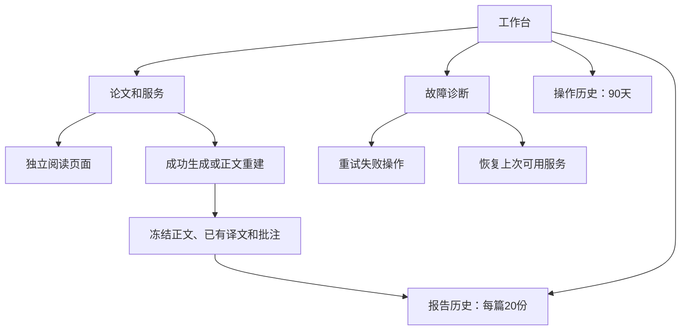

# 本地论文工作台

入口为 `http://127.0.0.1:8765/`。工作台统一管理论文和服务，阅读页面独立打开。

## 论文和服务

论文列表支持搜索、状态筛选、别名和置顶。论文身份仍由真实根目录和主入口共同确定。
每篇论文分别保留一个持续预览槽位和一个差异报告槽位。
归档前必须停止该论文的所有服务。归档仅隐藏论文记录，保留源码、配置和历史。
恢复归档后，可以再次启动原服务。

故障面板提供两个独立操作：

1. **重试失败操作**：使用失败操作保存的参数，创建新的操作记录。文件已失效时说明原因。
2. **恢复上次可用服务**：使用最后成功配置。该操作不代表重试失败的新基线。

日志面板显示对应服务的最后 64 KiB 日志。它不是按操作精确切分的日志。
工作台不自动重启失败服务。更新失败时，现有服务回退机制仍可恢复旧服务。

## 历史规则

操作记录持久保存 90 天。入口重启会将未完成操作标记为中断失败。
操作历史从升级后开始，不从旧日志推测历史。

差异报告成功生成、替换或正文重建后，工作台保存只读快照。
快照冻结当时已有的译文和批注。仅译文或批注变化不生成新快照。
每篇保留最近 20 份快照。新快照持久保存成功后，系统才淘汰最旧快照。
首次启用会导入当前可用差异报告，并标记“启用工作台时导入”。
导入在入口启动后于后台执行，工作台仍可查询状态和停止服务。
导入中断后，下次启动继续处理。只有快照持久保存后，系统才标记导入完成。

快照保存失败不撤销当前报告。工作台单独显示错误，并提供重试保存。
旧快照清理失败时保留记录，重试保存会继续清理；手动删除失败也可以重试。
历史报告可以阅读、搜索和查看冻结批注，不提供修改批注、修改源码或新翻译操作。
打开旧快照时，服务使用当前阅读脚本。保存的正文、译文、批注和时间均不改写。
历史报告仍可联网加载公式渲染依赖，不承诺完全离线。
旧报告的翻译清单不兼容时，快照保留内嵌译文，并注明未载入旧缓存。
系统不会把旧缓存重新解释为当前保护规则，也不会因此重新请求翻译。

## 存储和边界

论文别名、置顶和归档状态保存在入口的 `registry.json`。
操作记录和快照索引位于入口状态目录的 `history/history.sqlite3`。
快照文件位于 `history/reports/`，与可清理的工作进程报告副本分开。
重建关联信息放在报告目录旁的隐藏标记文件中，不参与报告正文。

管理写入沿用入口令牌验证。历史资源只允许读取快照索引登记的文件。
历史 HTML 使用独立的浏览器沙箱，不能调用活动论文的写入接口。
上传流程不依赖工作台在线。
