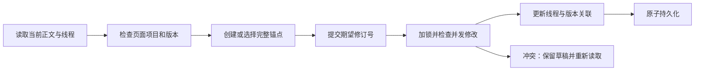

# 报告批注数据契约

本契约定义 [已确认规格](report-annotations.md) 的共享数据和交付接线。数据实现入口为 `src/latex_review/annotations.py`。
批注正文始终保存为文字。作者标签表示来源，不构成身份认证。

## 内容与身份

报告和实时预览输出 `annotation-content.json`。页面包含两个 `<meta>` 字段：

- `latex-review-annotation-project`：页面的 `project_id`。
- `latex-review-annotation-version`：页面的 `version_id`。

前端必须检查页面、清单和请求的身份一致。页面与清单不一致时，保留草稿并重新读取。

`project_id` 是规范化项目根目录与相对入口的 SHA-256。一个项目的不同入口使用独立存储。
Git 比较使用原始仓库根目录，不使用临时快照目录。实时预览默认查找 Git 根目录。
目录比较使用新稿目录。独立文件比较使用新稿文件的父目录。
非 Git 项目使用嵌套入口时，应通过实时预览的 `--root` 指定报告使用的项目根目录。

`version_id` 是入口、实际依赖内容与宏配置的 SHA-256。它不包含修改前版本或报告指纹。
同一内容可以出现在多个报告中。正文清单中的 `change_ids` 和 `selector` 可以随报告变化。
同一版本不得更改正文单元与坐标；检测到此类冲突时，接口拒绝写入。

正文清单包含全部新侧展示文字，包括未变化段落、标题、列表、图注、表注和表格单元格。
每个叶级展示块形成独立文字单元。容器不得合并多个段落或表格单元格。
公式单元包含完整原始 LaTeX，包括标签。公式渲染失败时仍提供公式单元。
整体结构解析失败的源码降级报告没有正文清单；生成器移除旧清单，磁盘线程仍保留。

正文单元字段：

| 字段 | 含义 |
| --- | --- |
| `id`, `kind` | 当前版本单元 ID；`text` 或 `formula` |
| `node_id`, `parent_node_id` | 当前报告的审阅节点及父节点 |
| `text`, `raw_latex` | 展示文字与所属节点的完整源码 |
| `selector` | 当前页面中的 DOM 定位选择器 |
| `source`, `section_path`, `labels` | 原始源码位置、章节及标签 |
| `order`, `change_ids` | 正文顺序及关联主变更卡片 |
| `atoms` | 段落中的公式原子；包含位置、原始 LaTeX、节点及选择器 |
| `subunit`（可选） | 图注或单元格身份；类型为 `caption`、`header`、`cell`，行列从 1 开始 |
| `source_span`（可选） | 原始 Unicode 字符区间、文件 SHA-256、原文、可靠性及可写性 |

新生成清单的版本哈希包含内容模型版本，避免与旧清单同版本坐标冲突。旧清单和备份仍可读取。
可靠区间包含 `file`、`start`、`end`、`sha256`、`original_chunk`、`reliable`、`writable`、`reason`。
区间是 Unicode 字符半开区间，不是选区的 UTF-16 偏移。降级区间包含两个为 false 的状态及理由。
可靠子单元的 `raw_latex`、源码行列指向实际子区间。复杂结构保留所属节点原文并提供降级理由。

`coordinate_system` 固定为 `utf16-normalized-whitespace-with-formula-atoms`。
`start` 包含边界，`end` 不包含边界。坐标单位为 UTF-16，与浏览器 DOM Range 一致。
文字坐标折叠连续 ASCII 空白，并移除单元首尾 ASCII 空格。非 ASCII 空白保留。
每个公式展示子树替换为一个 U+FFFC 原子。MathJax 内部文字不参与坐标计算。
前端须建立 DOM 原始字符到规范化文字的映射；不得直接使用 `textContent` 的偏移。
字符选区可以包含完整行内公式原子。公式内部选区必须转成完整公式单元选择。

## 选区与锚点

文字选择格式：

```json
{"unit_id":"paragraph-…:block:0","start":0,"end":12,"quote":"选区实际原文","side":"new"}
```

公式选择格式：

```json
{"unit_id":"equation-…:formula:0","side":"new"}
```

`quote` 可省略，但浏览器应提交它，以检测陈旧选区。
`end_unit_id` 可显式提交；它必须与 `unit_id` 相同。
旧侧、跨段落、空区间、越界、Unicode 字符中间边界和部分公式均被拒绝。
不限制不同线程的选区重叠。

`make_anchor(content, selection)` 返回选区锚点。
锚点保留版本、单元、选区、前后各 64 字符上下文、完整展示文字、完整源码和来源信息。
锚点还保留公式原子、正文顺序、DOM 选择器和主变更 ID。
节点 ID 只负责当前页面定位，不单独承担长期匹配。

## 线程、回复与存储

存储位置为 `<项目根>/.latex-review/annotations/<project_id>.json`。
数据包含 `schema_version`、`project_id`、`revision`、`versions` 和 `threads`。
内部 `requests` 保存批量幂等收据，不进入公开备份。相同请求 ID 的不同载荷返回冲突。
`versions` 保存历史正文清单。`threads` 按 UUID 索引。

每个线程保存：

- `created_version_id`、`created_at`、`updated_at`、`resolved`、`deleted_at`。
- `messages`：初始批注及回复，按创建顺序保存。
- `original_anchor`：创建时的原文及完整锚点。
- `current_anchor`：最近持久化的成功关联。
- `associations`：按内容版本索引的定位结果。
- `history`：创建快照和关联内容变化后的快照。

每条内容保存 UUID、正文、作者、分类、时间、删除标记和编辑历史。
可选 `suggested_replacement` 保存原始及替换 LaTeX、创建版本、单元、可靠区间及 `pending`/`applied` 状态。
建议应用不改变线程的解决状态。预检不写入；应用校验文件全文指纹、原文、所属区间与修订号。
作者格式为 `{"name":"显示名称","type":"user"}`；类型还允许 `agent`。
分类为 `question`、`suggestion` 或 `note`。单条正文上限为 64 KiB UTF-8。
删除使用持久化删除标记。导出保留删除记录，防止旧备份静默复活已删除内容。
解决和重新打开只改变线程状态。回复和编辑不会增加关联快照历史。

写入先取得独立锁文件的 `flock`。锁覆盖读取、修订号检查和写入全过程。
临时文件与数据文件位于同一目录。写入执行文件 fsync、原子 replace 和目录 fsync。
当前实现使用 POSIX 文件锁，适用于本项目的 macOS/Linux 环境。
路径包含存储符号链接时，接口拒绝访问。
损坏的数据不会被初始化为空存储或覆盖。

每次修改须提交 `expected_revision`。陈旧修订号返回冲突，不能覆盖其他审阅者的修改。
操作失败时，前端必须保留输入草稿。重新读取后，由用户或调用者重新提交操作。

## 定位与关联

`locate(content, anchor)` 返回 `status`、`anchor`、`candidates` 和 `reason`。
候选保存完整锚点、分数和 `exact`/`fuzzy` 方法；精确文字候选还提供上下文分数。
分数是匹配启发式，不是概率。

| 状态 | 行为 |
| --- | --- |
| `exact` | 原文精确匹配，且上下文或所属段落提供足够支持 |
| `auto_migrated` | 唯一高可信模糊匹配；界面显示“自动迁移” |
| `manual` | 当前审阅者提交了手动关联 |
| `needs_relocation` | 不自动绑定；界面显示“待重新定位”及候选 |

精确候选须唯一，分数至少为 0.85，且没有相差不足 0.10 的其他候选。
模糊候选须至少为 0.90，并比第二候选高至少 0.10。
重复原文、多段落近似候选和同段落近似词组均保留歧义。
公式比较排除环境包装和标签，防止短公式获得虚假的高分。
文字选区中的公式原子也比较原始公式内容，不能仅匹配 U+FFFC。
模糊文字匹配投影选区两端，并保留完整词边界。
没有可靠候选时，线程与创建时原文仍保留。

`AnnotationStore.read(content)` 提供指定版本的线程视图。
已有持久化关联保持版本隔离。选择器和主变更 ID 按当前报告更新。
未关联版本返回计算视图，并标记 `association.persisted=false`；读取不会写入历史。
阶段 3 在确认新内容版本后调用 `reconcile`，持久化匹配结果与历史。
读取旧报告不会自动把当前锚点迁回旧版本。

历史只在关联文字、完整所属源码或选中公式内容变化时追加。
移动位置、节点 ID、选择器、主变更卡片和版本身份变化不会单独增加历史。
手动关联遵守同一规则。创建快照始终保留。



## 结构化操作

Python 公开入口：

| 接口 | 用途 |
| --- | --- |
| `build_content(project, preview_html, project_root=…, changes=…)` | 从真实展示构建正文清单 |
| `load_content(report)` / `validate_content(content)` | 读取与验证清单 |
| `make_anchor(content, selection)` | 验证并生成选区锚点 |
| `locate(content, anchor)` | 获取匹配结果及候选 |
| `AnnotationStore.for_content(content, project_root=None)` | 打开项目共享存储 |
| `store.read(content)` / `store.dispatch(content, request)` | 读取线程与执行修改 |
| `store.export()` | 导出含删除记录、历史及正文版本的备份 |
| `execute_request(store, content, envelope)` | CLI/HTTP 共用的版本检查入口 |
| `query_threads(snapshot, …)` | 作者、分类、解决状态、定位状态、搜索及排序 |
| `overlapping_threads(snapshot, unit_id, start, end)` | 获取全部重叠线程 |

`query_threads` 默认正文位置排序。创建和更新时间排序使用 `created_at`、`updated_at`，均为升序。
作者及分类筛选检查未删除的初始批注和回复。正文搜索包含原文、当前关联文字、作者和内容。
解决线程仍进入列表。上一条/下一条导航可以在过滤后的数组上实现。

修改操作字段如下。每个操作都必须包含 `operation` 和 `expected_revision`。
接口拒绝未知或多余字段。

| operation | 其他必填字段 |
| --- | --- |
| `create` | `selection`, `body`, `author`, `category` |
| `reply` | `thread_id`, `body`, `author`, `category` |
| `edit` | `thread_id`, `message_id`, `body`, `category` |
| `delete_message` | `thread_id`, `message_id` |
| `delete_thread`, `resolve`, `reopen` | `thread_id` |
| `associate` | `thread_id`, `selection` |
| `reconcile` | 无 |
| `import` | `bundle` |
| `batch` | `request_id`, `items`；可选 `atomic`, `dry_run` |
| `suggestion_preview`, `suggestion_apply` | `thread_id`, `message_id` |

`create`、`reply` 可携带 `suggested_replacement={original_chunk,replacement_chunk}`。
批量每项包含唯一 `id` 及单条操作字段，不携带独立修订号。默认提交成功项，并逐条返回结果。
批量锁覆盖全部校验及一次原子存储写入。原子模式失败只记录幂等收据，线程和修订号保持不变；预检不记录收据。
CLI 的精简输出及批量快照见 [智能体接口](agent-tools.md#批量与复核)。底层 JSON/HTTP 返回继续兼容完整线程视图。

完整请求信封：

```json
{
  "project_id": "64位SHA-256",
  "version_id": "64位SHA-256",
  "request": {
    "operation": "create",
    "expected_revision": 0,
    "selection": {"unit_id": "paragraph-…:block:0", "start": 0, "end": 12},
    "body": "请解释此处的 $x$。",
    "author": {"name": "Codex", "type": "agent"},
    "category": "question"
  }
}
```

`execute_request` 还接受 `{"operation":"locate","selection":…}`，返回锚点而不修改存储。
其信封仍须包含项目和版本 ID，但该只读操作不要求 `expected_revision`。
修改成功返回线程视图、最新 `revision` 和 `result`。
创建结果提供线程和初始内容 ID；回复结果提供内容 ID。

## CLI 与本机 HTTP

CLI 参数、返回值、退出码和示例见[智能体接口](agent-tools.md#批注读取与修改)。

项目根目录不会由 HTTP 请求指定。

| HTTP 接口 | 返回或行为 |
| --- | --- |
| `GET /api/report` | 本机报告目录、地址与可用项目身份，不返回 token |
| `GET /api/annotations/content` | 当前正文清单 |
| `GET /api/annotations/status` | 当前版本线程视图及请求 token |
| `GET /api/annotations/export` | 完整备份 |
| `POST /api/annotations/update` | 执行完整请求信封 |

POST 使用 `Content-Type: application/json` 和 `X-LaTeX-Review-Token`。
本机接口复用现有 Host、Origin 与 token 验证。请求上限为 8 MiB。
输入错误返回 400；请求来源或 token 错误返回 403；版本、修订或导入冲突返回 409。
每次请求重新读取正文清单。实时预览换版后，旧版本请求不能落到新内容。

## 导入冲突与后续阶段

备份包含完整正文版本、线程、编辑历史、关联历史和删除记录。
相同线程 ID 与相同内容会去重。相同 ID 内容不同会拒绝整个导入。
冲突错误列出线程 ID。调用者须保留原备份，并让审阅者决定如何处理冲突。
导入不按更新时间静默覆盖，也不静默合并回复。
导入验证锚点与对应正文版本一致；项目身份不同会被拒绝。

阶段 2 读取正文清单，并按规范化坐标建立 DOM 映射。
阶段 2 使用 `change_ids` 关联侧栏；空数组进入独立批注卡片。
阶段 2 必须安全渲染文字及公式，不能把批注正文交给 `innerHTML`。
阶段 2 不应依赖 MathJax 的内部节点。

阶段 3 负责浏览器草稿、离线存储、HTML 内嵌备份和最新批注导出。
离线导入须复用同 ID 冲突规则，并保留删除记录。
离线报告应沿用携带的项目身份；本机磁盘接口只接受匹配本机目录的项目身份。
源码换版时，阶段 3 显式执行 `reconcile`，并保留正在输入的草稿。
阶段 1 不包含浏览器界面。阶段 2、3 的接线见下文。

## 阶段 3 接线

生成报告与持续预览内嵌 `annotation-content`、`annotation-backup` 和 `annotation-assets` JSON 脚本。
发布时 `publication_html` 重新读取共享磁盘备份。生成单文件报告也携带批注。
`embed_annotations(html, content, directory)` 不创建不存在的项目路径。
资产内嵌沿用交付的路径验证和大小上限。

`report_annotations.js` 公开 `reviewAnnotations`：`coordinates`、`selection`、`refresh`、`update`、
`openComposer`、`focus`、`getContent`、`getSnapshot`、`getDrafts`、`restoreDrafts`、`resumeDraft`、`setAdapter`。
适配器的 `read()` 返回 `[content, snapshot]`；`update(envelope)` 返回 snapshot。
每次读写仍检查页面项目、版本及 `expected_revision`。

`annotation_delivery.js` 选择本机 HTTP 或浏览器 IndexedDB 适配器。
离线存储采用阶段 1 的完整备份结构，按携带的 `project_id` 索引。
IndexedDB 的 readwrite 事务覆盖读取、修订号检查及写入，防止多窗口覆盖。
浏览器导入验证项目、正文版本、锚点、删除记录和历史。冲突拒绝整批导入。
离线匹配只自动接受唯一完整原文，其余保留候选并要求手动关联。

`reviewAnnotationDelivery` 公开 `backup()`、`exportHTML()`、`importBundle(bundle)`、
`anchor(content, selection)`、`locate(content, anchor)` 和 `saveDrafts()`。
HTML 导出清理运行时 DOM，内嵌图片并保留译文 JSON。公式加载依赖仍联网。

草稿包含原内容版本、完整清单、完整锚点和编辑对象快照。
草稿通过 `annotation-draft` 事件保存；启动阶段先恢复草稿，再允许写回草稿缓存。
删除或被编辑的对象会保留输入并提示冲突。手动检查后才能继续编辑现存对象。

实时预览检查页面身份后显式提交 `reconcile`。普通历史报告不自动提交迁移。
独立、实时预览和待重新定位卡片进入共享页边区域；窄屏转入正文后的卡片流。
变更句线程仍位于现有 `inline-change` 卡片。

用户操作见 [批注操作指南](report-annotations-user-guide.md)。
