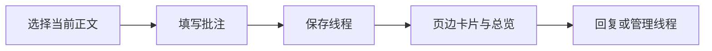

# 报告批注操作

报告和持续预览使用同一套批注。作者标签表示来源，不是身份认证。

1. 在修改后正文中选择单个段落内的文字。点击“新建批注”。
2. 点击公式节点，选择完整公式。MathJax 内部字符不提供独立坐标。
3. 填写显示名称、身份、分类和正文。点击“保存”。
4. 在卡片中回复、编辑、删除、解决或重新打开线程。
5. 打开“批注”总览。使用筛选、搜索和上一条/下一条定位线程。

文字按纯文本保存。`$x+1$` 或 `\(x+1\)` 表示行内公式。
`$$x+1$$` 或 `\[x+1\]` 表示块级公式。公式渲染需要联网加载 MathJax。
批注公式渲染失败时保留输入原文。用户输入不会作为 HTML 执行。

## 换版和草稿

持续预览保存源码后自动刷新。页面保留正文、作者、身份、分类及操作对象。
草稿按项目及页面路径隔离。关闭编辑器也会保留草稿。
正文未变化且匹配唯一时，草稿恢复原选区。不能可信匹配时，草稿保留输入。
此时重新选择当前段落或完整公式，再保存草稿。旧版本偏移不会直接用于新版本。

本机持续预览会持久化新版本关联。唯一高可信修改显示“自动迁移”。
歧义或删除显示“待重新定位”。卡片展示原文、候选及“手动重新关联”。
点击该按钮，再选择当前正文。卡片折叠展示历次关联快照。
打开历史报告只读取该版本关联，不会把最新关联迁回旧版本。

编辑对象被删除或修改时，页面保留输入并提示冲突。
“检查当前操作对象”重新读取对象。检查现有内容后可以继续编辑仍存在的对象。

## 保存和分享

本机服务保存到论文项目的 `.latex-review/annotations/<project_id>.json`。
同一项目、同一入口的报告和持续预览共享磁盘批注。

`file://` 和没有本机 API 的静态 HTTP 报告使用 IndexedDB。
同一浏览器来源内，同项目窗口通过事务保存，并通知其他窗口重新读取。
浏览器来源包含协议、主机及端口。不同来源、浏览器配置或设备不会自动同步。
清除浏览器数据会删除离线批注和草稿。请使用导出备份保存更新。

“导出批注 JSON”包含删除记录、正文版本和关联历史。
HTML 和 JSON 携带完整源码快照，包括所在正文单元的源码注释。
页面不会把这些快照自动显示为论文正文。
“导入批注 JSON”去重相同记录。同 ID 内容不同会拒绝整批导入并列出冲突。
原备份文件仍保留。页面不会根据更新时间静默覆盖冲突记录。
携带备份与浏览器记录冲突时，页面保留浏览器记录并提示冲突。
“导出报告原备份”可取出报告携带的原始记录。

“导出最新 HTML”携带最新批注、当前清单和本地图片。
导出会清除运行时卡片、选区标记及 MathJax 产物。新页面重新构建界面。
联网公式依赖仍保留。原有报告交付继续携带已有译文。

源码降级报告没有可靠正文清单，因此不能新建正文批注。
磁盘中的线程保留。结构预览恢复后可以重新定位。
分享报告不会创建不存在的本机论文目录。
离线匹配使用更保守的唯一完整原文规则；修改后的正文需要手动关联。
